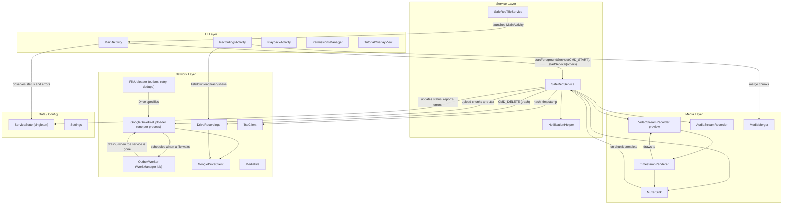
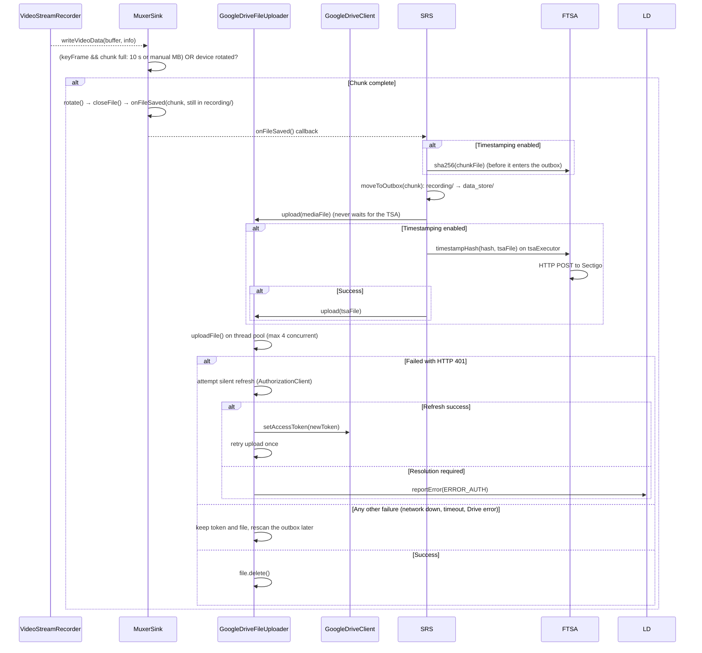
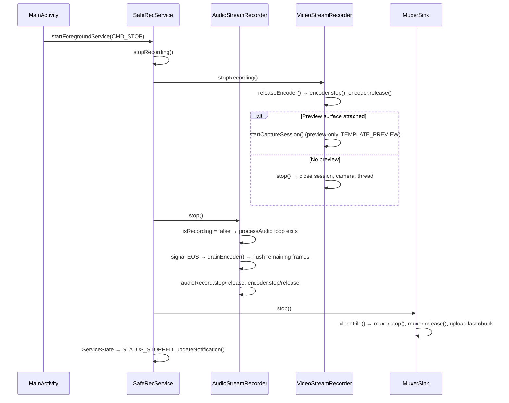

# SafeRec — Application Architecture

> **Package:** `net.ark3us.saferec`
> **Platform:** Android (Camera2 API, MediaCodec, MediaMuxer)
> **Purpose:** Background audio/video recording with chunked upload to Google Drive

---

## High-Level Architecture



---

## Reliability Rules

The app exists to save evidence when things go wrong. Keep these invariants:

1. **Record first, sync later.** Starting a recording never waits for the network, Drive or a valid token. Chunks wait on disk until an upload succeeds.
2. **Errors never stop a recording.** Upload, auth and TSA failures are reported as error events; only a total loss of camera *and* microphone ends a session.
3. **Network errors are not auth errors.** Only HTTP 401 triggers a token refresh. The background never clears the stored token: when a silent refresh needs user interaction, it reports `ERROR_AUTH` and keeps the files. Play services also ask for interaction when they cannot reach Google, and a cleared token stopped every later upload until the user reopened the app.
4. **Chunks never wait for the TSA.** Hash first, upload, then timestamp the hash.
5. **Degrade gracefully.** Camera lost → continue audio-only.
6. **The outbox holds ready chunks only.** A chunk is written in `recording/` and moved to `data_store/` once closed and hashed for the TSA, so the outbox can be uploaded at any time, even mid-recording. Hashing after the move let a rescan or the outbox job upload and delete a chunk before its hash was taken, leaving it without a timestamp.
7. **A failed lookup is not "not found".** Drive folders are created only when Drive answered that they do not exist, and only under the uploader's lock. Treating a timeout as "not found" created duplicate `SafeRec` folders and split sessions between them.
8. **The outbox outlives the service.** Every file waiting in the outbox has a WorkManager job behind it, and so does the chunk being recorded. A chunk recorded offline, or cut by a power cut, reaches Drive after a kill or a reboot without the user opening the app.

---

## Package Structure

```
net.ark3us.saferec/
├── MainActivity.java          # Main UI, preview, start/stop, settings
├── RecordingsActivity.java    # Browse/download/merge/share recordings from Drive
├── RecordingsAdapter.java     # RecyclerView adapter for recordings list
├── QuickStartActivity.java    # The one entry of every quick start; the only screen over the lock screen
├── CameraGesture.java         # The optional camera double press (enables a disabled activity alias)
├── PlaybackActivity.java      # Video playback (streaming from Drive)
├── PermissionsManager.java    # Runtime permissions + Google Drive OAuth
│
├── data/
│   └── ServiceState.java      # Service status and one-shot errors, observed by the UI
│
├── media/
│   ├── VideoStreamRecorder.java  # Camera2 + MediaCodec video encoder (singleton)
│   ├── AudioStreamRecorder.java  # AudioRecord + MediaCodec AAC encoder
│   ├── MuxerSink.java            # MediaMuxer wrapper: chunks, one A/V clock, outbox hand-off
│   ├── ChunkPolicy.java          # When a chunk is full (10 s, or a manual size)
│   ├── WorkDir.java              # Where chunks are written; moves leftovers only while no recording uses it
│   ├── SampleJournal.java        # A chunk's sample log (formats, sizes, times), kept until it is closed
│   ├── ChunkIndex.java           # Finds the samples of a cut chunk from its log (pure Java)
│   ├── ChunkRepair.java          # Rebuilds a playable MP4 from a cut chunk and its log
│   ├── VideoOrientation.java     # Orientation math (snap, hint per camera facing)
│   ├── MediaMerger.java          # Merges MP4 chunks into a single file
│   └── TimestampRenderer.java    # OpenGL ES 2.0 pipeline for burned-in timestamp overlay
│
├── misc/
│   └── Settings.java          # SharedPreferences wrapper
│
├── net/
│   ├── FileUploader.java         # Outbox queue, retry backoff, dedupe, drain (abstract: tested with a fake)
│   ├── GoogleDriveFileUploader.java  # Drive upload, folder cache, token refresh (one per process)
│   ├── OutboxWorker.java         # WorkManager job: uploads the outbox when the service is gone
│   ├── OutboxBootReceiver.java   # After a boot with files left: the expedited outbox job
│   ├── GoogleDriveClient.java    # Low-level Drive API wrapper
│   ├── DriveRecordings.java      # Recordings on Drive: list, download, share, trash
│   ├── MediaFile.java            # Chunk filename parser/generator
│   ├── SessionManifest.java      # What a session recorded (chunks, sizes, SHA-256); gaps against Drive
│   ├── EvidencePackage.java      # The zip handed over: merged video, Drive files, README, report, verifier
│   ├── SessionCheck.java         # The verifier's checks, on the phone, before a session is handed over
│   └── TsaClient.java            # RFC 3161 Time Stamping Authority client (Sectigo)
│
│
├── services/
│   ├── SafeRecService.java       # Foreground service orchestrating recording
│   ├── SafeRecTileService.java   # Quick Settings tile: starts a recording through QuickStartActivity
│   ├── StartPolicy.java          # What CMD_START and CMD_SWITCH_CAMERA do (pure Java)
│   ├── SafeCount.java            # Which uploaded files count as "pieces safe"
│   ├── Haptics.java              # Two short pulses on start, one long on stop, three short when nothing records
│   └── NotificationHelper.java  # Notification channel + builder
│
└── ui/
    └── TutorialOverlayView.java  # First-run tutorial overlay

guard/                          # Separate Gradle module: the three power-key presses (see Quick Start)
└── net/ark3us/saferec/guard/
    ├── TriggerRule.java          # Three screen changes within 2.5 s, 5 s cooldown (pure Java)
    ├── GuardService.java         # specialUse foreground service, listens to SCREEN_ON/OFF
    ├── Guard.java                # Status, settings intents, ensureRunning()
    ├── GuardBootReceiver.java    # BOOT_COMPLETED and MY_PACKAGE_REPLACED: starts the guard
    └── GuardWatchdog.java        # 15-minute WorkManager job that restarts a dead guard
```

---

## Recording Lifecycle (Detail)

### 1. Start Recording


### 2. Chunking & Upload (during recording)



Failures are classified from the error itself. An extra request to check the token would run later, could find the network back, and would say nothing about the failure. A 404 (a cached Drive folder was deleted) also clears the folder cache.

Token refreshes are shared: one at a time (`refreshLock`), at most one Play services request per minute.
- A token Drive already rejected, or a missing token, goes straight to the refresh instead of sending the chunk only to get another 401.
- A token the app stored meanwhile (the user opened it) is used without asking Play services.
- Before this, each failing chunk asked on its own (8 requests in 30 s), which can get the app throttled.

### Outbox & Retry

| Directory (under `files/`) | Holds |
|-----------|-------|
| `recording/` | The chunk being written |
| `data_store/` | The outbox: complete chunks and `.tsa` replies waiting for upload |

- `MuxerSink.closeFile()` hands a finished chunk over, still in `recording/`, and deletes empty ones. The service hashes it (TSA on), then renames it into the outbox (`moveToOutbox()`, same filesystem, atomic) and uploads it.
- `WorkDir.recover()` moves chunks left in `recording/` by a dead process (crash, kill, sudden power cut) into the outbox. Such a chunk has no MP4 index, so it is **repaired**, see Cut Chunk Repair below. `SafeRecService.onCreate()` (in the background: a repair can take seconds) and the outbox job call it.
- It moves nothing while a recording uses `recording/`. The service calls `WorkDir.acquire()` when a recording starts and `release()` once the post-processing of its last chunk is done (queued on the same executor). Moving the chunk being written would upload half a file, and moving a closed one before its post-processing would skip its TSA hash. One lock covers the counter and the moves, so a recording cannot start in the middle of a recovery. Under it the chunks are only renamed into `repair/`. The repairs run afterwards, under a lock of their own, so a recording start never waits for one.

### Session Manifest

Drive shows which chunks arrived, not which ones should have. `SessionManifest` keeps the list of what a session recorded: plain text a third party can read, one line per event, with Drive names, sizes and SHA-256.

```
started 0 1792426343499.0.mp4                       ← the chunk got its first sample
chunk 0 1792426343499.0.mp4 1107234 sha256=4fb5…    ← closed
repaired 1 ….1.mp4 359569 sha256=… original ….1.cut 359569 sha256=…
cut 2 ….2.mp4 12345 sha256=…                        ← recovered as it was (no usable log)
```

- **When.** `started` comes from `MuxerSink` at a chunk's first sample, not when its file opens: an empty chunk is deleted at close and must not look lost. `chunk` comes from the post-processing, with the hash taken before the chunk enters the outbox (now always, not only with timestamping on). `repaired` and `cut` come from the recovery (`ChunkRepair.beforeOutbox()`).
- **Where.** The master stays on the phone (`files/manifests/`, never deleted: a recovery days later appends to it). After each line a full copy goes to the outbox, and Drive keeps one copy, `{sessionId}.0.manifest` (`text/plain`), replaced in place (`files.update`, allowed by `drive.file` on the app's own files; the id is cached, so an update is one request).
- **A copy replaced while it uploads.** The next line can replace the outbox copy during its upload. The upload sends the bytes read at its start, then deletes the local copy only if it did not change, and otherwise sends the newer one too.
- **Timestamp.** With timestamping on, the manifest is timestamped when a recording stops (after its last chunk's line) and after a recovery changed it, as `{sessionId}.0.manifest.tsa`. Not after every chunk: that would double the requests to the TSA. The token proves the list of chunks and their hashes at that time, so a chunk removed from Drive later shows. The master is hashed under the manifest's lock, and the TSA asked outside it, so new lines never wait for the network.
- **Gaps in the list.** `DriveRecordings` reads each session's manifest and compares it with the `.mp4` files on Drive. Each missing chunk is "still on this phone" (outbox, `recording/` or `repair/`) or "recorded but missing on Drive". The session header shows it in red, also for a session with no chunk on Drive (all lost, or a recording whose first chunk is not uploaded yet). That header takes its place among the sessions, newest first: it used to go to the bottom of the list, below every older session. Gaps are computed from the manifest, not from consecutive sequence numbers, which can skip legitimately (an empty chunk).
- **Trash.** Selecting every chunk of a session also selects its manifest and timestamp, so the session folder empties and goes to the trash too.
- **Verified on a Galaxy S10+:**
  - A 25 s recording left one manifest on Drive with `started` and `chunk` lines for chunks 0-2, whose sizes and SHA-256 matched the downloaded chunks.
  - The manifest's timestamp held the SHA-256 of the manifest on Drive.
  - Once chunk 1 was trashed on Drive, the list showed "Recorded but missing on Drive: chunk 1".
- **Verifying a session.** `scripts/verify_session.py` (run with `uv run`) checks a session folder downloaded from Drive.
  - The manifest's timestamp, with `openssl ts -verify -digest` against certifi's Mozilla roots. Sectigo's tokens carry their whole chain (Signer R37, CA R41, Root R46, cross-signed by USERTrust RSA), so no extra certificate is bundled.
  - Every listed chunk, its own `.tsa`, and a repaired chunk's `.cut` and `.cut.tsa`.
  - The manifest only grows. When it no longer matches its timestamp, the verifier looks for a prefix that does: lines added later (a recovery after the stop) are reported as not covered, while an edited line matches no prefix and fails.
  - Its tests (`scripts/test_verify_session.py`) run offline, with a test TSA made with openssl. They cover a complete session, a missing, altered, never-closed or repaired chunk, lines added after the timestamp, an edited manifest, a token for another file and an untrusted authority. Four rules are checked by mutation.
  - Verified on a real session from the S10+ (a chunk and a repaired one, real Sectigo tokens): COMPLETE. Flipping one bit of a chunk, or deleting the cut original, made it fail.
- **Evidence package.** The package icon on a session header (`RecordingsActivity.exportSession()`) builds `SafeRec-<session>.zip` in `cache/merged_sharing/` and shares it:
  ```
  SafeRec-<session>/README.txt         plain language, in the app's language: what is inside, how to check it
  SafeRec-<session>/report.txt         start, duration, chunks with SHA-256 and timestamp times, manifest state, gaps
  SafeRec-<session>/merged.mp4         to watch (left out if the merge fails: the chunks are the evidence)
  SafeRec-<session>/evidence/<session>/<type>/   every file of the session, byte for byte as on Drive
  SafeRec-<session>/verify_session.py  so `uv run verify_session.py evidence` works inside the package
  ```
  - The verifier comes from `scripts/` at build time (`copyVerifier` in `app/build.gradle.kts`, a generated assets directory), so the app never ships a copy that drifted.
  - The report reads timestamp times with BouncyCastle (`TsaClient.read()`) and holds the phone's verdict (below).
  - Videos are stored in the zip, not deflated again.
  - A package of a long session weighs gigabytes and Android clears the cache only when space runs out. Opening the recordings screen deletes what is older than a day in `cache/merged_sharing/` and `cache/merging/` (`EvidencePackage.deleteOld()`): packages and merged videos already shared, and the downloads of an export or a merge cut short. A process that dies skips its own clean-up: a killed export once left 218 MB there. Not the files just shared: the receiving app may still be reading them.
  - **Checked on the phone first** (`SessionCheck`). The export runs the verifier's rules on the downloaded files: the manifest's timestamp (whole file or a prefix), every listed file with its size and SHA-256, a never-closed chunk, and every timestamp. A timestamp is valid when it certifies the file's SHA-256, its signature checks out (BouncyCastle `TimeStampToken.validate()`: a timestamping certificate, valid at that time) and its chain reaches a root Android ships (`CertPathBuilder`, PKIX, no revocation check, as `openssl ts -verify`). Roots the user added are left out: they could vouch for anything.
    - Same rules as `scripts/verify_session.py`, so both give the same verdict: keep them in step. `SessionManifest.entries()` parses the manifest as `parse_manifest()` does, and also feeds the gaps of the list.
    - A verified package is shared at once ("Verified on this phone"). Otherwise a dialog lists the problems before the share sheet. That is the one moment a missing chunk can still be fixed. A chunk still on this phone (outbox, `recording/`, `repair/`) adds "Upload now" (`CMD_UPLOAD_PENDING`), and a chunk missing but not here points to a list loaded before its upload. "Share anyway" leaves the choice to the user, and the verdict goes into `report.txt` either way.
    - A PKIX implementation that does not know the critical timestamping usage of the signer would reject every chain, so a `PKIXCertPathChecker` claims it. BouncyCastle checks it on the signer.
    - Verified on the S10+, with real Sectigo tokens and Android's roots:
      - a 7-chunk session: COMPLETE (7 files, 8 timestamps), shared at once, and the verifier said COMPLETE on the package;
      - exported while still recording: its open chunk was "still on this phone", and "Upload now" reached the service;
      - a chunk trashed on Drive: NOT VERIFIED in the dialog and in `report.txt`, "Share anyway" shared it, and the verifier failed it the same way.
    - Exporting while recording also showed chunks missing that had reached Drive after the list was loaded. The dialog then suggests refreshing the list.
  - Android collapses runs of spaces in string resources: the README and the report's column header are quoted in `strings.xml` to keep their layout.
  - Verified on the S10+. A session recorded with timestamping on was exported from the list. In the zip, following its README, the verifier said COMPLETE (manifest, 3 chunks, real Sectigo tokens). The merged video played 22 s, and the report was aligned.
- **Lessons from the test.** Drive's search (`files.list` with `trashed=false`) still returned a just-trashed file for a few seconds. And a JSON body passed through `adb shell` lost its double quotes: Drive ignored the body and answered with the file, which looked like a success.

### Cut Chunk Repair

MediaMuxer writes the MP4 index (`moov`) only when a chunk is closed. A crash, a kill or a power cut leaves a chunk whose samples are all in its `mdat` but cannot be found, and no player opens it (`moov atom not found`).

- **The sample log.** While a chunk is written, `MuxerSink` writes a log next to it (`SampleJournal`, `<chunk>.idx`). It holds the track formats with their codec configuration (SPS/PPS, AAC config), the orientation and, for every sample, its track, size in the file, time and flags. That is ~1.2 KB/s, flushed every 16 samples, and deleted once the chunk is closed. A failing log never stops a recording: the chunk is then just not repairable.
- **Finding the samples** (`ChunkIndex`). MPEG4Writer lays out ftyp, a reserved free box, then mdat with runs of samples of one track, each track in its recording order. A video sample starts with its own length (size minus 4), so at each position the next logged video sample either matches, or the next logged audio sample comes. Checked first on a complete chunk: from its sample sizes alone it rebuilt its index exactly (715 of 715). The log records video sizes as MPEG4Writer stores them: it replaces a leading 4-byte start code with the length, or adds the length when there is none.
- **Safe failure.** The walk stops at the first sample the file does not hold whole. It also stops when the log ran out before the file (not flushed when the power went) and the next bytes look like a video sample, rather than taking it for the next logged audio. If no logged video sample is found, the writer laid samples out differently and nothing is repaired. A chunk with its index is never repaired.
- **Rebuilding** (`ChunkRepair`). The located samples go, unchanged, into a new MP4 with MediaMuxer, with the logged formats, orientation and times. Video gets its start code back, since MediaMuxer writes the length itself.
- **Both reach Drive.** The playable copy goes under the chunk's name, and the cut file goes untouched as `<timestamp>.<seq>.cut`, typed `application/x-saferec-cut`. With `application/octet-stream` Drive looked at the content and filed it as video, whatever the metadata said. The recordings list lists `.mp4` files only. It hides the `.cut` and its `.cut.tsa`, marks the chunk "repaired after a cut, original kept", and trashes them all together.
- **Timestamps.** A cut chunk never got its TSA timestamp, since the hash is taken when a chunk closes. With timestamping on, the recovery hashes the files while they are still in `repair/` (`Repairer.beforeOutbox()`), before an upload can delete them:
  - the file that goes as the chunk (the repaired copy, or the original when it could not be repaired) gets `<base>.tsa`, paired with the chunk as usual;
  - a repaired chunk's original gets `<base>.cut.tsa`.

  They prove the bytes existed, unchanged, no later than the recovery. The tokens travel with their chunk into the outbox, and a token left in `repair/` by a recovery cut short goes as it is. Requests are quiet (no toast from background work) and, as for every chunk, not retried. Verified: both tokens on Drive held the SHA-256 of the file they certify, timed at the recovery.
- **Compound names.** `MediaFile` takes everything after `timestamp.sequence` as the extension, so `x.1.cut.tsa` is a `cut.tsa`. Taking only the first part made it a `cut`, uploaded under the original's very name.
- **What is lost:** the samples MediaMuxer still held in memory when the process died (~0.5 s), and on a real power loss whatever had not reached the flash yet.
- **Verified on a Galaxy S10+:** a force stop 5 s into a chunk left 472 KB and a 6.5 KB log. The repaired copy played 4.2 s (126 video, 178 audio samples, 0 decode errors with ffmpeg, rotation kept). The `.cut` on Drive had the same SHA-256 as the cut file on the phone, and the list showed the label.
- There is one `GoogleDriveFileUploader` per process (`getInstance()`), shared by the recording, `CMD_UPLOAD_PENDING` and the outbox job. The `queuedFiles` dedupe, the folder lock and the token refresh therefore cover all of them: two uploaders would each create the same Drive folders, or upload the same chunk twice.
- **No upload twice.** An upload can reach Drive while its answer never comes back: the process dies, or a timeout. The file then stays in the outbox and goes again, and Drive used to hold the chunk twice (seen three times with a force stop during an upload). Merging the session repeated it.
  - A chunk or `.tsa` that just entered the outbox is queued with `uploadNew()`: its first upload cannot be a repeat, so it goes straight.
  - Every other attempt is a retry, or a file found by a scan (maybe left mid-upload by a dead process). Those first ask Drive for that name in the session folder (`findFile()`). The same MD5 means the upload already happened: the local file is just deleted ("Already on Drive"). Another MD5 is uploaded anyway: evidence is never dropped on a guess.
  - Only the caller that queues the file decides it is new (a flag on the queuing, no shared set). If a scan queued it first, that upload checks, at the cost of one request.
  - Verified with the force-stop test that had duplicated chunk 0 three times out of three: the retry found it on Drive, and the session held each file once.
- Each upload uses the token the app stored last, unless Drive already rejected it. The uploader lives as long as the process, across services, and the user may have reconnected Drive meanwhile.

Who retries depends on whether the service is alive:

| Service | Retries | Survives |
|---------|---------|----------|
| Alive (recording, or `dataSync` with files waiting) | `FileUploader` retry loop (`setRetryLoop(true)` in `onCreate`) plus the network callback | Nothing: it ends with the service |
| Gone (killed, `onTimeout()`, phone rebooted) | The WorkManager job `outbox` (`OutboxWorker`) | Process death and reboot |

- When an upload fails while the service lives, its file stays in the outbox, and `FileUploader` schedules one outbox rescan: 10 s, doubling up to 5 min. `onDestroy()` turns the loop off: rescans in a process without a service are not run reliably.
- A successful upload rescans the outbox immediately and resets the backoff. So does the network coming back: the default network changing, gaining a transport, or turning `VALIDATED`. A new Wi-Fi network shows up before its DNS works, so the first retry fails and the `VALIDATED` one goes through (outbox drained in 6 s instead of 23 s).
- A VPN stays the default network and stays `VALIDATED` while the phone has no network under it, so `onAvailable` never fires. Its transports do change, from `WIFI|VPN` to `VPN` and back (measured on a Galaxy S10+), and that change is the trigger.

**The outbox job** (`OutboxWorker`):
- Scheduled with `ExistingWorkPolicy.KEEP` whenever a file is queued or its upload fails (`onFilePending()`), when a recording starts, and when the service starts with files waiting. While a job waits or runs, scheduling again does nothing, so calling it per chunk is cheap.
- It needs a network (`NetworkType.CONNECTED`) and runs 5 min after it was scheduled: while the service lives, the service does the work. A failed run comes back after 5 min, doubling up to WorkManager's 5 h cap.
- When the service is known to be gone, an **expedited** job (`scheduleNow()`, unique name `outbox-now`, `REPLACE` so an earlier run waiting in its backoff cannot delay it) goes as soon as there is a network: from `onDestroy()` when files wait (the `dataSync` time limit, or Android stopping the service), and from `OutboxBootReceiver` after a boot with files left. Android may hold the delayed job of an app in the background for a long time: on a Galaxy S10+ (Android 16) it stayed "ready", every constraint met, for 35 min without starting, with this build and the one before. The expedited job is not held back and gets the network. Out of quota it runs as a regular job; below Android 12 it is a regular job, since WorkManager would need a foreground notification for it.
- Several runs at once (the delayed and the expedited job) are harmless: they share the uploader, so each file is uploaded once.
- It first adopts the chunks left in `recording/` (`WorkDir.recover()`, with `ChunkRepair`), so a chunk cut by a sudden power cut is repaired and uploaded after the boot without opening the app.
- A run that finds a recording in progress queues a successor (`APPEND_OR_REPLACE`: with `KEEP`, scheduling does nothing while the job itself runs). Without it, a run that succeeded mid-recording left no job queued until the next chunk, and a power cut in that gap left the open chunk to the next app launch.
- It calls `drain()`, which uploads the outbox and blocks until it is empty (success), an upload failed or the job is stopped (retry later). Uploads already running for the recording are waited for, not started twice. Chunks recorded meanwhile are uploaded in the same run: success means an empty outbox.
- Verified on a Galaxy S10+ (Android 16):
  - After `onTimeout()` stopped the service, the expedited job uploaded the 2 waiting chunks 7 s after the network came back. Before it, the delayed job took 41-254 s, or did not start.
  - In a 15-minute run with recordings, the job also ran while the service was uploading, with no duplicate. A run that failed (network cut) came back 5 min later.
  - Sudden power cut, by hand (it needs an unlock): recorded 15 s offline, then `adb reboot` 5 s into the second chunk. It sent no `ACTION_SHUTDOWN`, so the open chunk stayed in `recording/` without its index (`moov atom not found`). After the unlock, with the network back and the app never opened, `OutboxBootReceiver` queued the expedited job. That job adopted the cut chunk and uploaded both 12 s after the network returned. With only the delayed job, nothing ran in 11 min.
  - A force stop in the middle of a recording left the open chunk too. Android 15+ sends `BOOT_COMPLETED` to an app leaving the stopped state, WorkManager rescheduled, and the job adopted and uploaded it.
- Before this job, chunks left offline waited for the user to open the app again whenever the service was gone. That happened after a reboot, after the process was killed (a sticky restart only lasts until Android stops background services), or after the Android 15 `dataSync` cap.

### 3. Stop Recording



### 4. Camera Switch Mid-Recording

When the user switches front↔back during recording, [SafeRecService](app/src/main/java/net/ark3us/saferec/services/SafeRecService.java) receives `CMD_SWITCH_CAMERA` (a `CMD_START` while recording is ignored):

1. [stopRecording()](app/src/main/java/net/ark3us/saferec/MainActivity.java) — tears down audio, video, and muxer (uploads final chunk)
2. [startRecording()](app/src/main/java/net/ark3us/saferec/services/SafeRecService.java) — creates a **new muxer** in the same session, re-opens the **other camera** than the running recording's, with the **same type** (video)
3. This is a full restart, not a hot swap — there's a brief gap in the recording

The service remembers the running recording's type (`currentDataType`) and camera (`recordingFront`), because a quick start records with its own settings, not the viewfinder's. Taking them from the viewfinder turned an audio-only quick start into video (in another folder of the session, with its own manifest) and could leave the camera unchanged. The service also stores the new camera as the viewfinder's (`useFrontCamera`), so the viewfinder shows what is recorded; `MainActivity` only sends the command while recording, and switches its own preview otherwise. An audio-only recording has no camera to switch: the command is ignored and logged.

### 5. Preview Lifecycle (Independent of Recording)

| State | Action |
|-------|--------|
| **App opens (not recording)** | [startPreview()](app/src/main/java/net/ark3us/saferec/media/VideoStreamRecorder.java) → opens camera, preview-only session (`TEMPLATE_PREVIEW`) |
| **App opens (recording in progress)** | [attachPreview()](app/src/main/java/net/ark3us/saferec/media/VideoStreamRecorder.java) → rebuilds capture session with preview + encoder |
| **App goes to background (recording)** | [detachPreview()](app/src/main/java/net/ark3us/saferec/media/VideoStreamRecorder.java) → rebuilds capture session without preview |
| **App goes to background (not recording)** | [stop()](app/src/main/java/net/ark3us/saferec/media/VideoStreamRecorder.java) | closes camera entirely |
| **Recording stops (app visible)** | [stopRecording()](app/src/main/java/net/ark3us/saferec/MainActivity.java) | releases encoder, rebuilds preview-only session |

### 6. Playback Lifecycle

- `PlaybackActivity` uses `android:configChanges` for orientation/screen changes.
- Video layout is recalculated in `onConfigurationChanged()` using cached prepared dimensions to keep aspect ratio correct after rotation.


## Key Classes

### [VideoStreamRecorder](app/src/main/java/net/ark3us/saferec/media/VideoStreamRecorder.java) — [VideoStreamRecorder.java](app/src/main/java/net/ark3us/saferec/media/VideoStreamRecorder.java)

**Singleton.** Manages Camera2 device, preview, and H.264 MediaCodec encoder.

| Field | Type | Notes |
|-------|------|-------|
| `muxer` | `volatile MuxerSink` | Set during recording, null otherwise |
| `isRecording` | `volatile boolean` | True when encoder + muxer are active |
| `encoder` | `MediaCodec` | H.264 encoder (Surface input) |
| `encoderSurface` | [Surface](app/src/main/java/net/ark3us/saferec/MainActivity.java) | Input surface from encoder |
| `cameraDevice` | `CameraDevice` | Currently open camera |
| `captureSession` | `CameraCaptureSession` | Active session |
| `previewSurface` | [Surface](app/src/main/java/net/ark3us/saferec/MainActivity.java) | From TextureView, null when no preview |
| `quality` | [Quality](app/src/main/java/net/ark3us/saferec/media/VideoStreamRecorder.java) | LOW (640×360), MEDIUM (854×480), HIGH (1280×720) |

Key methods:
- [initCamera(context, useFront)](app/src/main/java/net/ark3us/saferec/media/VideoStreamRecorder.java) — shared setup (sync quality, camera thread, preview size)
- [setupEncoder(context, cameraId)](app/src/main/java/net/ark3us/saferec/media/AudioStreamRecorder.java) — creates & starts MediaCodec with async callback
- [startCaptureSession()](app/src/main/java/net/ark3us/saferec/media/VideoStreamRecorder.java) — builds targets list (encoder + preview), sets repeating request
- `openCamera(...)` + request generation guard — ignores stale `onOpened` callbacks after stop/restart to avoid resurrecting dead sessions
- [releaseEncoder()](app/src/main/java/net/ark3us/saferec/media/VideoStreamRecorder.java) — stops & releases encoder safely
- [configureTransform(textureView)](app/src/main/java/net/ark3us/saferec/media/VideoStreamRecorder.java) — corrects preview for device rotation

**Orientation** ([VideoOrientation](app/src/main/java/net/ark3us/saferec/media/VideoOrientation.java), pure Java, unit tested):

- The device orientation comes from an `OrientationEventListener` (accelerometer). It works with the screen off (phone in a pocket) and with auto-rotate disabled, unlike the display rotation used before.
- It is snapped to 0/90/180/270 with a 15° hysteresis past the 45° boundaries, so a phone held at ~45° does not split the recording into tiny chunks.
- A phone lying flat reports nothing: the last orientation is kept. Until the first reading, the display rotation is the starting guess.
- **Hint** = `(sensor + device) % 360` for the back camera, `(sensor - device) % 360` for the front one. The front camera faces the other way. Using the back formula for both turned front videos upside down in landscape.
- On a change, the timestamp overlay turns at once. The encoder is asked for a key frame (`PARAMETER_KEY_REQUEST_SYNC_FRAME`), and `MuxerSink` starts the chunk with the new hint at that key frame. A chunk split elsewhere would start with frames that cannot be decoded.
- Verified hand-held on a Galaxy S10+ with the front camera: portrait, landscape, the other landscape and back to portrait all played upright. Every chunk started with a key frame, 23-52 ms after the turn.
- Turning from one landscape to the other passes through portrait, which leaves a short chunk (~0.5 s). A duration split just before a turn leaves one too. Both are harmless. A debounce would remove them, at the cost of recording the first part of every real turn sideways.

### [AudioStreamRecorder](app/src/main/java/net/ark3us/saferec/media/AudioStreamRecorder.java) — [AudioStreamRecorder.java](app/src/main/java/net/ark3us/saferec/media/AudioStreamRecorder.java)

Manages `AudioRecord` (mic input) and AAC MediaCodec encoder on a background thread.

- **Sample rate:** 44100 Hz, mono, PCM 16-bit
- **Bitrate:** 64 kbps AAC-LC
- **Timestamps:** `CLOCK_BOOTTIME` of the first captured frame (`AudioRecord.getTimestamp`, falling back to the read time), then the sample count: never jittery, never backwards.
- **No dropped PCM:** when the encoder has no free input buffer, the loop drains output and waits. Dropping a buffer used to shorten the audio timeline and shift all later audio against the video.
- **Stop sequence:** signals EOS to encoder, drains remaining output, then releases

Key methods:
- [processAudio()](app/src/main/java/net/ark3us/saferec/media/AudioStreamRecorder.java) — loop: read PCM → queue to encoder → [drainEncoder()](app/src/main/java/net/ark3us/saferec/media/AudioStreamRecorder.java)
- [drainEncoder(bufferInfo)](app/src/main/java/net/ark3us/saferec/media/AudioStreamRecorder.java) — pulls encoded AAC from encoder, writes to muxer

### [MuxerSink](app/src/main/java/net/ark3us/saferec/media/MuxerSink.java) — [MuxerSink.java](app/src/main/java/net/ark3us/saferec/media/MuxerSink.java)

Thread-safe (`synchronized`) wrapper around `MediaMuxer` with automatic chunking and upload.

| Concept | Implementation |
|---------|---------------|
| **Track readiness** | Waits for both audio+video tracks (or just audio if audio-only) before `muxer.start()` |
| **Pending packets** | Buffers up to 100 packets while tracks aren't ready |
| **Chunk rotation** | When the chunk is full (duration or size limit): on a video key-frame, or on any audio packet when there is no video. Also at the first key frame after the device orientation changes (one MP4 holds one orientation hint) |
| **Camera lost** | `setExpectedVideo(false)`: following chunks carry audio only (still under the `video` folder) |
| **One clock** | Video timestamps are brought to `CLOCK_BOOTTIME`, the audio clock. The camera uses `BOOTTIME` or `MONOTONIC` depending on the device, and the closer clock is picked on the first frame. |
| **PTS normalization** | One session base for both tracks (first packet written) → chunk base = first packet of the chunk minus `CHUNK_LEAD_US` (1 s) → final. The lead keeps packets of the other track captured just before the chunk's first packet, instead of dropping them. The MP4 writer moves the earliest sample to 0, and the tracks keep their real offset (edit list). |
| **File naming** | `{sessionId}_{dataType}_{timestamp}.{seq}` via [MediaFile](app/src/main/java/net/ark3us/saferec/net/MediaFile.java) |
| **Sample log** | `<chunk>.idx` next to the open chunk, so a cut chunk can be repaired (see Cut Chunk Repair) |

**Chunk limit** is determined by:
1. Manual setting (`Settings.getChunkSizeMB`) if > 0: split by size, no duration limit
2. Otherwise (auto): split by duration, `ChunkPolicy.DEFAULT_DURATION_MS` = 10 s (wall clock), for both video and audio-only

Duration, not bytes, is what bounds data loss: a static or dark scene compresses well and would otherwise stretch a size-based chunk.

### [TsaClient](app/src/main/java/net/ark3us/saferec/net/TsaClient.java)

Utility to obtain cryptographically secure RFC 3161 timestamps.

- **Hash:** SHA-256
- **Provider:** `https://timestamp.sectigo.com` (Sectigo)
- **Library:** BouncyCastle (for TSQ/TSR handling)
- **Local Cache:** Saves `.tsa` files side-by-side with media chunks during background upload.
- **Off the critical path:** `sha256()` runs before the chunk upload; `timestampHash()` only needs the hash and runs later on `SafeRecService.tsaExecutor`, so a slow TSA never delays uploads. Failed timestamps are not retried.


### [TimestampRenderer](app/src/main/java/net/ark3us/saferec/media/TimestampRenderer.java) — [TimestampRenderer.java](app/src/main/java/net/ark3us/saferec/media/TimestampRenderer.java)

OpenGL ES 2.0 pipeline that composites a burned-in date/time overlay onto camera frames before they reach the encoder. Always active during video recording.

- **Pipeline:** Camera → SurfaceTexture (OES texture) → GL render (camera quad + timestamp quad) → encoder input Surface → MediaCodec
- **GL thread:** Dedicated `HandlerThread` ("TimestampGL") for all EGL/GL operations
- **Shaders:** OES external sampler for the camera pass-through, regular `sampler2D` for the text bitmap overlay
- **Text rendering:** Android `Canvas` draws the current date/time into a `Bitmap`, uploaded as a GL texture; only regenerated when the wall-clock second changes
- **Orientation:** The overlay position is defined in "display NDC" and rotated by `+recordingRotation` (CCW in GL = inverse of player's CW rotation) to map to raw-frame NDC. This single rotation matrix handles both position and text orientation for all four orientations (0°/90°/180°/270°).
- **Preview/recording parity:** Uses the same raw camera frames as the encoder (no extra sensor-rotation transform) so the recorded video orientation matches what the player expects.
- **Presentation time:** Forwards the `SurfaceTexture` timestamp to EGL via `eglPresentationTimeANDROID` for correct A/V sync
- **Preview:** The renderer only feeds the encoder. The preview Surface (TextureView) is a separate camera target, so the on-screen preview does not show the overlay.
- **Integration:** Created in `VideoStreamRecorder.setupEncoder()` for every video recording; its input surface replaces `encoderSurface` in the camera capture session targets.

### [MediaMerger](app/src/main/java/net/ark3us/saferec/media/MediaMerger.java) — [MediaMerger.java](app/src/main/java/net/ark3us/saferec/media/MediaMerger.java)

Merges multiple MP4 chunks into a single file. Used by [RecordingsActivity](app/src/main/java/net/ark3us/saferec/RecordingsActivity.java) when user taps "Merge".

- Reads video/audio formats from the first chunk
- Strips `KEY_ROTATION` from format, applies rotation via `setOrientationHint` only
- Concatenates samples with PTS offset tracking per track. Each track continues where it ended in the previous file, measured from its own first sample. Only in the first file is the gap between the tracks kept, because there it is the real offset between microphone and camera start.
- **Limitation:** Single MP4 = single rotation value. Mixed-camera sessions or merged chunks with different device rotations will have wrong orientation on some segments.

### [SafeRecService](app/src/main/java/net/ark3us/saferec/services/SafeRecService.java) — [SafeRecService.java](app/src/main/java/net/ark3us/saferec/services/SafeRecService.java)

Foreground service orchestrating the recording. Commands via `Intent` extras:

| Command | Action |
|---------|--------|
| `CMD_START` | (`startForegroundService`) Starts a recording. **Ignored while recording**, so a second quick start never cuts the session (`StartPolicy`). With `EXTRA_QUICK_START` (set by `QuickStartActivity`) it records with the quick-start settings, not the viewfinder's choices. It always enters the foreground; while recording, with the running recording's type, so an ignored start never drops the camera type |
| `CMD_SWITCH_CAMERA` | (`startService`) While recording video: stop + restart with the other camera and the same type (a new muxer, see Camera Switch). Ignored when not recording, or when recording audio only. It never enters the foreground on its own |
| `CMD_STOP` | Stop recording, reset session |
| `CMD_UPLOAD_PENDING` | Upload the outbox now (safe while recording) |
| `CMD_DELETE` | Move Drive files (`EXTRA_FILE_IDS`) to the Drive trash, never delete them for good. Folders (`EXTRA_FOLDER_IDS`) are trashed only when they hold nothing, not even trashed files. Deleting a folder for good would also delete the trashed files in it, and keeping it lets Drive's "Restore" put files back where they were. |

State is broadcast via the [ServiceState](app/src/main/java/net/ark3us/saferec/data/ServiceState.java) singleton: `STATUS_READY` → `STATUS_STARTED` → `STATUS_STOPPED`.

Errors are a separate one-shot channel (`reportError()` / `getError()` / `clearError()`): `ERROR_AUTH` (Drive needs re-authentication), `ERROR_CAMERA` (camera lost, recording continues audio-only), `ERROR_RECORDING` (nothing can be recorded). Errors never change the recording status and never stop a recording.

Camera/encoder callbacks are posted to the main thread (`onVideoResult`) and ignored if they belong to a previous session.

**Foreground lifecycle** (`refreshForeground()`, always on the main thread, posted after each state change):

| State | Foreground | Notification |
|-------|------------|--------------|
| Recording video | `camera\|microphone` | Recording in progress |
| Recording audio only | `microphone` | Recording in progress |
| Not recording; files in the outbox, uploads, TSA or trashing running | `dataSync` | What is running, or "N files waiting to be uploaded" |
| Nothing left | leaves the foreground, `stopSelfResult(lastStartId)` | none |

- **The notification** (`NotificationHelper`):
  - It is shown at once (`FOREGROUND_SERVICE_IMMEDIATE`, API 31+), not after Android's ~10 s deferral.
  - While recording it holds a chronometer counting from the session's start, and the count of safe pieces ("N pieces safe on Drive", a plural string): the chunks of the current session that reached Drive (`SafeCount`, `FileUploader.UploadListener.onFileUploaded`, `ServiceState.getSafeChunks()`).
  - Its Stop action needs the phone unlocked (`setAuthenticationRequired(true)`, API 31+). Below API 31 the action opens the app, which needs the unlock anyway.
  - Visibility is secret (`VISIBILITY_SECRET`): on a secure lock screen it is hidden whatever the user's lock-screen setting, so whoever holds a locked phone does not learn that SafeRec records. It used to be private with a public version ("SafeRec · Active"), but SystemUI redacts a private notification only when the user chose "hide sensitive content": under the common default "show all content" it showed in full, chronometer and safe count included. Android's own camera and microphone indicator still shows: it cannot be hidden.
- Haptics (`Haptics`): two short pulses when a recording starts, one long pulse when it stops, none on a camera switch. The `vibrations` setting turns them all off.
  - A start vibrates only once something records (`confirmStart()`): when the microphone starts, or, if it failed, when the camera does. It used to vibrate right after the start command, also when nothing could record (an audio-only start without the microphone, or neither microphone nor camera: `QuickStartActivity` does not check the permissions).
  - A start that records nothing gives three short pulses instead (`Haptics.failed()`), so a blind start never confirms a recording that is not there.
  - A quick start that finds a recording running is ignored, but vibrates two short pulses again: a first confirmation that went unnoticed must not push the owner to unlock the phone and check. Not while the running start still waits for its own confirmation. An ignored start from the app vibrates nothing.
- Only `CMD_START` is sent with `startForegroundService()`, and the service enters the foreground before anything else. Other commands use `startService()`: with `startForegroundService()` the service would have to enter the foreground even with nothing to do, or crash.
- Work counters (`activeTimestamping`, `activeDeletions`) go up when the work is submitted, not when its task starts. Otherwise the service could stop in between and drop the work.
- Sticky restart after the process was killed: Android forbids entering the foreground from the background, so the service never tries. It resumes the outbox as a plain background service for as long as Android lets it run. Verified on a Galaxy S10+: the waiting chunk was uploaded after the kill, with no crash.
- Android 15+ caps `dataSync` at 6 h a day: `onTimeout()` stops the service, and the outbox job takes over.

**Phone switching off** (`onShutdown()`): power key, reboot, or an empty battery, which Android shuts down cleanly at ~1%.
- Android sends `ACTION_SHUTDOWN` only to receivers registered at runtime: the service registers one in `onCreate()`. Android waits up to 10 s in all for them.
- While recording, it calls `stopRecording()` on the main thread, so the open chunk gets its MP4 index. It then waits up to 3 s for the post-processing (hash, move to the outbox) and up to 2 s for WorkManager to store the outbox job (`OutboxWorker.scheduleAndWait()`). After the next boot, `OutboxBootReceiver` sees the waiting files and the expedited job uploads them.
- Before this, the power cut left the open chunk without its index (it needed repair tools to play), and in `recording/`, where only the next service start moved it to the outbox.
- Verified on a Galaxy S10+ (Android 16) with `adb shell svc power reboot`, which goes through the framework shutdown like the power menu. `adb reboot` does not: it sends no `ACTION_SHUTDOWN` (checked), so it stands for a sudden power cut.
  - The shutdown came 5 s into the second chunk while offline. The recording was closed, with 2 files in the outbox and the job stored, 0.45 s after the broadcast.
  - After the boot, `recording/` was empty and the last chunk played (6.2 s, audio and video).
  - Once the network was back, the job uploaded both chunks without the app being opened.

### [Settings](app/src/main/java/net/ark3us/saferec/misc/Settings.java) — [Settings.java](app/src/main/java/net/ark3us/saferec/misc/Settings.java)

SharedPreferences wrapper. Keys:

| Setting | Type | Default |
|---------|------|---------|
| `accessToken` | String | null |
| [onlyAudio](app/src/main/java/net/ark3us/saferec/misc/Settings.java) | boolean | false |
| `useFrontCamera` | boolean | false |
| `videoQuality` | String | "LOW" |
| `chunkSizeMB` | int | 0 (auto = 10 s chunks) |
| `quickStartAudioOnly` | boolean | false (a quick start records video) |
| `quickStartFrontCamera` | boolean | false (a quick start uses the back camera) |
| `vibrations` | boolean | true |
| `tutorialShown` | boolean | false |
| `shareEmail` | String | "" (last address recordings were shared with) |
| `timestampingEnabled` | boolean | false |

The old `autoStartOnLaunch` setting is gone: the tile, the shortcut and the power key always record at once.

Security note:
- `SafeRecPrefs.xml` is excluded from Android cloud backup/device transfer/full backup rules to avoid backing up the Drive access token.


---

## Quick Start

Recording must start with the phone locked, in a pocket, without looking. Every way in goes through one screen, `QuickStartActivity`.

```
 power key x3 ──► GuardService ──┐
 tile (locked too) ──────────────┤
 shortcut "Record now" ──────────┼──► QuickStartActivity ──► CMD_START + EXTRA_QUICK_START ──► SafeRecService
 camera double press (optional) ─┘     (black, over the lock screen)
```

- **`QuickStartActivity`** shows over the lock screen and turns the screen on: `android:showWhenLocked` and `android:turnScreenOn` in the manifest (the camera alias inherits them), plus `setShowWhenLocked()` / `setTurnScreenOn()` at runtime and the window flags on API 26. The manifest attributes are what the tile needs: on Android 14+ it starts the activity through a `PendingIntent`, and SystemUI decides whether to ask for the unlock from the manifest's flags, before the activity runs. With the runtime calls alone, the tile asked for the PIN. It is black, with a "Recording" description for screen readers only, and never shows the camera or any recording. It sends `CMD_START` with `EXTRA_QUICK_START` once: a recreated activity (the screen coming back on) sends nothing, but still finishes like the first one, so its black screen never stays up. It does not rotate (`nosensor`), which would recreate it. The start is wrapped in a try/catch: the activity runs in the recording's process, and an unexpected refusal must not crash a recording in progress. Locked, it finishes after 1.5 s. Unlocked, it opens `MainActivity`, already recording. `MainActivity` itself never shows over the lock screen.
- **What it records.** The quick-start settings (`quickStartAudioOnly`, `quickStartFrontCamera`: video and back camera by default), not what was last picked on the viewfinder.
- **Tile and shortcut.** The tile (`SafeRecTileService`) and the static shortcut "Record now" start `QuickStartActivity` with source `tile` / `shortcut`. The tile works from the lock screen without unlocking. Source `power` comes from the guard and `camera` from the double press.
- **Stopping is deliberate.** Nobody stops a recording from the lock screen: the notification's Stop needs authentication (see the notification above).
- **Commands from other apps.** `MainActivity` is exported and runs the `command` extra it is launched with. Release builds accept only `CMD_START` there and log any other command as ignored: any installed app could otherwise stop a recording. Debug builds (`BuildConfig.DEBUG`) accept every command, because `scripts/device-tests.sh` stops recordings that way.

### Three presses of the power key

No public API reports power key presses. Each press turns the screen on or off, and Android broadcasts `ACTION_SCREEN_ON` / `ACTION_SCREEN_OFF`.

- **The guard** (`GuardService`, module `guard/`) is a foreground service of type `specialUse` that registers a runtime receiver for both broadcasts. Its notification is permanent, minimum importance and secret on the lock screen.
- **The rule** (`TriggerRule`): three screen changes within 2.5 s trigger, then nothing for 5 s. It counts changes in a window and does not measure the rhythm, because `SCREEN_OFF` arrives ~0.4 s after its press (after the screen-off animation): presses 0.37 s apart were measured as 737 ms and 66 ms.
- **Why an activity.** A service cannot enter the foreground with the camera or microphone type from the background (`SecurityException`). A visible activity can start that service, so the guard starts `QuickStartActivity` by component name, with source `power`.
- **Why it is allowed.** The user grants "Display over other apps" (`SYSTEM_ALERT_WINDOW`). With it, Android lets the guard start an activity from the background (`BAL_ALLOW_SAW` in the system log). Without it, Android does not throw: the guard logs `trigger refused: no overlay permission`.
- **Logs.** `Guard running`, `Guard stopped`, `Guard cannot start`.
- **Measured in a spike** (Galaxy S10+, Android 16, locked with a PIN, screen off): video recording 0.6 s after the third press, the trigger screen visible 30-54 ms after the trigger, the phone stayed locked.
- **Screen changes that are not presses.** Nothing is filtered, not even during a phone call: a deliberate start must never be blocked. A camera double press (two presses under 300 ms) gives at most two changes and does not trigger the guard.
- **Costs.** A permanent notification, the overlay permission granted once, and a `specialUse` foreground service.

### Keeping the guard alive

On the S10+ the low-memory killer killed the app twice in a minute, with 0.5 GB free, and Android postponed the sticky restart by up to 165 s. Android 15+ does not let a service restarted in the background return to the foreground, so a killed guard would stay dead until the app opens.

- **Battery exemption.** The setup sends the user to the system page of battery optimization (`ACTION_IGNORE_BATTERY_OPTIMIZATION_SETTINGS`), not the direct dialog: that needs `REQUEST_IGNORE_BATTERY_OPTIMIZATIONS`, which Play checks closely. An exempt app may return to the foreground from the background.
- **Watchdog.** `GuardWatchdog` is a periodic WorkManager job (`guard-watchdog`, 15 minutes, the minimum) that calls `Guard.ensureRunning()`. `ensureRunning()` also re-arms the job, which a restored or reset WorkManager loses.
- **Boot and update.** `GuardBootReceiver` restarts the guard on `BOOT_COMPLETED` and `MY_PACKAGE_REPLACED`.
- **Status** (`Guard.status()`): `DISABLED`, `NEEDS_OVERLAY`, `NEEDS_BATTERY_EXEMPTION`, `STOPPED`, `ACTIVE`, in the order the user has to fix them. The app says so when the three presses are off.
- To be verified on a device (plan Task 12): that `specialUse` starts from `BOOT_COMPLETED` on Android 15+, that the exemption brings a killed guard back, and the behavior of the guard while a call is on.

### Build switch

`saferec.powerGesture` in `gradle.properties` (default `true`). With `-Psaferec.powerGesture=false` the `guard` module is `compileOnly`: nothing of it is packaged, so the APK has no guard manifest entries (the `specialUse` service and its permission, the overlay permission, the boot receiver), and the app shows no setting or first-run step for it (`BuildConfig.POWER_GESTURE`). This is the build for Google Play if the `specialUse` declaration is refused.

### Camera double press (optional)

The double press of the power key opens the default camera app with `STILL_IMAGE_CAMERA` (unlocked) or `STILL_IMAGE_CAMERA_SECURE` (locked).

- `CameraGestureAlias` is an activity alias for `QuickStartActivity` with both filters, **disabled** in the manifest. `CameraGesture.setEnabled()` turns it on when the user chooses so. A permanent declaration would show a chooser on phones with a second camera app, and on the lock screen that choice needs an unlock first.
- Android stores the "Always" choice per action, so each intent needs its own. "Try it now" therefore goes in two steps (`CameraGesture.tryIntents()`): `STILL_IMAGE_CAMERA` first, then, when the user comes back to `MainActivity`, a second dialog sends `STILL_IMAGE_CAMERA_SECURE`. With the first try only, the setup covered the unlocked phone, and the double press of a locked phone still opened the other camera app. The next step is a static field (`cameraGestureNextTry`): a try that reaches SafeRec recreates `MainActivity` (`QuickStartActivity` opens it with `CLEAR_TOP`).
- Once the user picks SafeRec as "Always" for both, the double press records, locked or not. Undo: Settings, Apps, SafeRec, Open by default.
- The dialog says that trying it starts a short recording, which the user then stops (a second try while it runs is an ignored quick start), and that the lock screen's camera shortcut may start SafeRec too: it sends the same intents.
- The option reads "Double press of the power key opens SafeRec": "camera double press" did not say which key.
- It is offered only when SystemUI's `config_cameraGesturePackage` does not pin another camera app (`CameraGesture.isAvailable()`, `allowsOtherApps()`). If SystemUI cannot be read, it is offered, and "try it now" shows whether it works.
- To be verified on a device (plan Task 12): the double press itself, and the Pixel's camera gesture setting.

### Google Play declaration

Foreground service type `specialUse`, to paste in the Play Console. The subtype is the value of `PROPERTY_SPECIAL_USE_FGS_SUBTYPE` in `guard/src/main/AndroidManifest.xml`:

> Personal safety: start a recording with three presses of the power key, with the phone locked
>
> No other foreground service type fits: none covers listening for a user gesture while idle to start a safety recording, and the camera and microphone types cannot be started from the background, which is where the gesture is heard.

---

## Data Flow

### File Storage & Naming

```
/data/data/net.ark3us.saferec/files/
  ├── recording/                                      ← chunk being written, with its sample log (.idx)
  ├── repair/                                         ← cut chunks taken from recording/ for their repair
  ├── manifests/{sessionId}_{video|audio}.txt         ← session manifest masters, kept
  └── data_store/                                     ← outbox, ready files only
      ├── {sessionId}_{video|audio}_{timestamp}.{seq}.mp4 / .tsa / .cut / .cut.tsa
      └── {sessionId}_{video|audio}_{sessionId}.0.manifest / .manifest.tsa  ← copies to upload
```

`sessionId` = `System.currentTimeMillis()` at session start.

### Google Drive Structure

```
My Drive/
  └── SafeRec/
      └── {sessionId}/
          └── {video|audio}/
              ├── {timestamp}.{seq}.mp4        ← chunk (or the repaired copy of a cut one)
              ├── {timestamp}.{seq}.tsa        ← its RFC 3161 timestamp (timestamping on)
              ├── {timestamp}.{seq}.cut        ← a repaired chunk's untouched original
              ├── {timestamp}.{seq}.cut.tsa    ← the original's timestamp, taken at recovery
              ├── {sessionId}.0.manifest       ← session manifest, one copy, updated in place
              └── {sessionId}.0.manifest.tsa   ← its timestamp, at stop and after a recovery
```

Chunks are uploaded immediately on completion and **deleted locally** on successful upload. When duplicate `SafeRec` folders exist (made by older builds), uploads go to the oldest and the recordings list reads all of them.

---

## Threading Model

| Thread | Components |
|--------|-----------|
| **Main (UI)** | MainActivity, RecordingsActivity, service commands |
| **CameraBackground** (HandlerThread) | Camera2 callbacks, MediaCodec encoder callbacks (video) |
| **Audio processing** (Thread) | `AudioStreamRecorder.processAudio()` loop |
| **Upload pool** (4 threads) | `FileUploader.uploadExecutor` |
| **Upload scan** (1 thread) | `FileUploader.scanExecutor`: outbox scans and the scheduled retry rescan |
| **WorkManager** (its own pool) | `OutboxWorker.doWork()`: blocks in `drain()` while the upload pool does the uploads |
| **Network callback** (system thread) | `SafeRecService.networkCallback`: `retryNow()` when the default network changes, gains a transport or turns `VALIDATED` |
| **Service executor** (1 thread) | `SafeRecService.executor` for pending uploads |

### Thread Safety Notes

- [MuxerSink](app/src/main/java/net/ark3us/saferec/media/MuxerSink.java): all public methods are `synchronized`
- `VideoStreamRecorder.muxer` and `.isRecording`: `volatile` for cross-thread visibility
- `VideoStreamRecorder.cameraOpenRequestCount`: `AtomicInteger` generation guard against stale async camera-open callbacks
- `AudioStreamRecorder.isRecording`: `volatile`, checked in processing loop
- `GoogleDriveFileUploader.sessionFolderIdCache`: `ConcurrentHashMap`
- `GoogleDriveFileUploader.cachedBaseFolderId`: `volatile` + double-checked locking
- `GoogleDriveFileUploader.refreshLock`: one token refresh at a time. `GoogleDriveClient.accessToken`/`driveService` are `volatile`, because a refresh replaces them while uploads run
- `FileUploader.queuedFiles`: concurrent set; a file is queued at most once, so a pending-files scan cannot upload a chunk that is already in flight (that used to create duplicates on Drive)
- `WorkDir`: one per process; its lock covers the recording counter and the recovery moves
- `GoogleDriveFileUploader.getInstance()`: `static synchronized`, one uploader per process, so the dedupe and the folder lock above also hold between the service and the outbox job
- `FileUploader.listener` and `.retryLoop`: `volatile`, set by the service on the main thread and read by the upload threads

---

## Release Build

R8 shrinks and optimizes the release (`isMinifyEnabled`, `isShrinkResources` in `app/build.gradle.kts`). The APK went from 16.8 MB to 3.9 MB.

- **Rules.** The libraries bring their own. google-api-client fills its model classes (Drive `File`, `FileList`, `Permission`, error replies) by reflection on `@Key` fields: those rules ship with play-services-auth. WorkManager creates workers by class name, and Room and androidx.startup are covered too. `app/proguard-rules.pro` adds two things only:
  - line numbers in stack traces;
  - the app's own class names (`-keepnames`). The source is public, so renaming hides nothing, and it would turn the log tags (`Class.getSimpleName()`) into single letters. Unused code is still removed.
- **Keep each release's `app/build/outputs/mapping/release/mapping.txt`**, e.g. uploaded to the Play Console. Without it, library frames in a crash report cannot be read.
- **`r8test` build type.** It is the release, shrunk the same way, but signed with the debug key. Because it shares the debug signature:
  - it installs over the debug app (`adb install -r`) and keeps its data;
  - the Google consent still works, since OAuth knows the debug SHA-1. A release-signed build would need the debug app uninstalled first.

  It is not debuggable, so `run-as` and `scripts/device-tests.sh` do not work with it. Change the settings with the debug build before installing it, and put the debug build back afterwards (`adb install -r -t`).
- **Verified with `r8test` on a Galaxy S10+**, with no crash:
  - the Play services authorization and the Drive token check;
  - a recording uploaded with its TSA timestamps (BouncyCastle);
  - the recordings list, and playback streamed from Drive;
  - the settings sheet;
  - the outbox job;
  - an evidence package and its phone check: signatures and certificate chains (BouncyCastle, `CertPathBuilder`) said COMPLETE, as in the debug build.

  Check these again after adding a library or anything that uses reflection.

---

## Known Limitations

1. **Camera switch = recording gap.** Switching cameras mid-session does a full stop+restart, creating a new muxer/session segment.
2. **Mixed-rotation merge.** A single MP4 can only have one `setOrientationHint`. When chunks from different cameras (with different sensor orientations) or different device rotations are merged, some segments will display with wrong rotation.
3. **No video mirroring.** Front camera video is recorded un-mirrored (you see yourself as others see you, not as a mirror reflection). This is standard for video recording.
4. **Background Auth Failure.** If Drive rejects the access token (HTTP 401) during background upload, the app attempts a silent token refresh via Google Identity Services. If successful, the upload seamlessly resumes. If the refresh requires user interaction (e.g., token revoked or password changed), it reports `ERROR_AUTH`, prompting the user to re-authenticate, and keeps the token and the files. Later retries try the silent refresh again (at most once a minute), so uploads resume once Play services can issue a token. The recording keeps going.
5. **Slow failure behind a VPN.** With a VPN app keeping its tunnel up while the phone has no network, packets vanish and each Drive call fails only after its 20 s timeout instead of at once. Uploads that were already running when the network dropped fail when it returns, and are retried.
6. **Preview rebuild failure drops video.** `onConfigureFailed` during `attachPreview`/`detachPreview` is handled like a camera loss: the rest of the session is audio-only.
7. **A/V sync is as good as the capture timestamps.** Both tracks share `CLOCK_BOOTTIME`, but MediaMuxer does not signal the AAC encoder delay, so audio plays ~20-45 ms late. That is within lip-sync tolerance. Audio clock drift (sample rate vs system clock, typically <100 ppm) is not corrected within a session: <0.36 s per hour in the worst case.

   Measured with the `av_sync` vibration rig on a Galaxy S10+ (the rig adds its own constant, so compare values, not the absolute):
   - After a camera switch (cold camera start): +71..98 ms, versus +540..613 ms before the shared clock.
   - In a merged 50 s file: a slope of +0.9 ms/min, versus -53.5 ms/min before the fix.

   Before the shared clock, each track was normalized to its own first packet. Audio was off by the camera start delay (0.2 s with the preview open, ~1 s cold), and 1-3 audio frames were dropped at every chunk boundary, so merged files drifted further with every chunk.

8. **drive.file reaches only the app's own files.** If the `SafeRec` folder holds a file the app did not create (an older build with another OAuth client, or a file added by hand), Drive refuses any change to the folder's sharing with `appNotAuthorizedToChild`. That covers sharing it from the app and removing a public link that older builds created. Both must then be done in the Google Drive app.
9. **Sharing is per person.** The share button grants one Google account read access to the whole `SafeRec` folder, future sessions included, and Google emails that person. The app never creates "anyone with the link" access, and it cannot revoke a share: that is done in Drive.
10. **Android decides when the outbox job runs.** The delayed job of an app in the background can be held for over half an hour. The expedited one covers the cases the app sees coming (service stopped, boot), so this matters after a kill without notice: those chunks wait for that delayed job or the next app launch. In Doze jobs wait for a maintenance window, an app the user rarely opens gets fewer runs (App Standby buckets) and less expedited quota, and after repeated failed runs the job waits up to 5 h. A force stop cancels the jobs until the app leaves the stopped state. After a reboot nothing runs before the first unlock, because the outbox is in credential-encrypted storage. While the service lives, none of this applies.
11. **A sudden power cut still costs the last moment.** Without a clean shutdown (a battery that fails before Android's ~1% shutdown, a kernel crash), the open chunk is cut. It is repaired from its sample log and uploaded after the boot without opening the app, but the last ~0.5 s that MediaMuxer held in memory is lost. On a real power loss, so is what had not reached the flash yet. Without a usable log the cut chunk is uploaded as it is, and plays only after repair tools.
12. **The three presses depend on the guard being alive.** The guard is off after a reboot until the first unlock (its boot receiver is not direct-boot aware and the app's data is credential-encrypted). The low-memory killer can kill it, and Android postpones its restart. The watchdog brings it back within 15 minutes, only with the battery exemption. The tile, the shortcut and the app always work.

---

## Testing on a Device

Unit tests (JVM, no phone, under a second): `./gradlew testDebugUnitTest`. The session verifier's tests: `uv run --with pytest --with certifi pytest scripts/test_verify_session.py -q --basetemp=tmp/pytest`.
- `VideoOrientationTest`: quadrant snapping with hysteresis, hint for back and front cameras.
- `ChunkPolicyTest`: 10 s auto chunks whatever the size, manual size only.
- `MediaFileTest`: chunk, `.tsa`, `.cut` and `.cut.tsa` names, Drive names, foreign names rejected.
- `TsaClientTest`: SHA-256 against the FIPS test vector.
- `WorkDirTest` covers:
  - leftovers moved and empty ones dropped, nothing moved while a recording uses the directory;
  - a camera switch (two recordings overlapping), an extra release;
  - a chunk with its log repaired with the original kept as `.cut`, a failed repair sending the original;
  - a repair cut short starting over, leftovers and stray logs dropped;
  - timestamps made before the outbox going along with their chunk, an unrepaired chunk timestamped as it is, a timestamp left in `repair/` sent as it is.
- `StartPolicyTest`: a start while recording is ignored, a camera switch restarts only while recording, unknown commands do nothing.
- `SafeCountTest`: only the `.mp4` chunks of the current session count as safe.
- `CameraGestureTest`: the gesture is offered unless another camera app is pinned.
- Module `guard` (`bash ./gradlew :guard:testDebugUnitTest`): `TriggerRuleTest` (three changes within the window, the cooldown) and `GuardStatusTest` (the order of the statuses).
- `SampleJournalTest`: round trip, a record cut short, a foreign file.
- `EvidencePackageTest`: the zip's layout (Drive's, under `evidence/`), videos stored and the rest deflated, files byte for byte, a package without merged video, the report's lines, day-old files deleted.
- `SessionCheckTest`: the verifier's cases, with a test authority made with BouncyCastle (a root and a timestamping certificate). It covers:
  - a complete session, a missing, altered or never-closed chunk, a repaired chunk with its original;
  - lines added after the manifest's timestamp, an edited manifest;
  - another file's timestamp, a tampered signature, an untrusted authority;
  - no timestamps at all, a chunk outside the manifest, no manifest.

  Nine rules are checked by mutation (hash, signature, chain, imprint, manifest prefix, later lines, never closed, original, any token).
- `SessionManifestTest`: line format, the last state of each chunk (a late `started` never undoing it), gaps split into on this phone and lost, no gap in a complete session, the manifest and its timestamp updated in place.
- `ChunkIndexTest`, on synthetic chunks laid out like MPEG4Writer's:
  - every sample of a cut chunk found in place;
  - a complete chunk left alone;
  - a log behind the file never placing a sample wrong;
  - video that does not match the log never taken as video.

  The `WorkDir` and `ChunkIndex` rules are checked by mutation.
- `FileUploaderTest`: the outbox logic with a fake uploader and millisecond backoff. It covers:
  - queuing once while uploading;
  - retry from the outbox, and no retry with the loop off;
  - a success releasing waiting files at once, and `retryNow()`;
  - `drain()`: empty outbox, a failure, waiting for an upload already running, chunks recorded meanwhile, stopping;
  - repeat uploads: a new file's first upload goes straight, a retry and a file found in the outbox ask the server first;
  - a finished upload reported to the listener.

  Breaking the dedupe, the success trigger, the loop switch, any `drain()` rule or the repeat check fails the matching test (checked by mutation).


`scripts/device-tests.sh` drives a connected phone (debug build) and checks logcat, the chunk store and chunk durations with ffprobe. Scenarios: `offline_start`, `audio_only`, `camera_stolen`, `replay`, `errors_dont_stop`, `network_drop`, `retry_after_outage`, `outbox_job`, `tsa`, `av_sync`, plus a whole-run crash check. It toggles airplane mode, records camera and mic, rewrites SafeRec settings, and restores everything on exit. It refuses to run if the outbox or `recording/` is not empty.
- `ANDROID_SERIAL` must name the test phone, or the script refuses to run. A manual test script, which did not pin the device, once ran on the owner's everyday phone plugged into the same cable. It installed SafeRec there (in the Private space too: `adb install` installs for every user), cleared the log buffer and toggled airplane mode.

- `av_sync` checks sync on the content.
  - It switches camera at 3 s (a cold camera start), then vibrates the phone with 80 ms pulses at seeded irregular times. Long pulses (250 ms) failed in dim light: long exposures show motion mostly when the motor starts and stops, and the two make rival correlation peaks ~0.25 s apart. The motor is one physical event seen by both tracks: the buzz reaches the microphone and the shake moves the image.
  - `scripts/av_lag.py` cross-correlates the buzz envelope with the motion on textured pixels, per chunk.
  - It records 50 s and measures every chunk after the switch with a clear correlation peak. It passes when the median lag is within ±250 ms and at most one chunk is more than 40 ms from it. One chunk can lock onto a stray movement or noise, which once failed a run that two reruns passed. It skips when the camera used after the switch sees too dark a scene (the phone must lie so that camera sees a lit room).
  - Its own FAIL on the pre-fix build (+540..570 ms) confirmed it catches the bug.
- `outbox_job` records offline and then ends the service the way Android does. It shortens the `dataSync` time limit to 20 s (`device_config put activity_manager data_sync_fgs_timeout_duration`, removed afterwards), so `onTimeout()` stops the service. The limit must be set before the stop: Android fixes it when `dataSync` starts. Back online, it waits for the job's own run (nothing forced; the expedited job from `onDestroy()` goes within seconds) and checks that the job uploaded every chunk with no service alive.
  - The process is not killed. `run-as kill` is forbidden by SELinux, and `am force-stop` cancels the job.
  - `am kill` is logged as a user request (`REASON_USER_REQUESTED`), and WorkManager takes that for a force stop. Its rescheduling finished the system job while the worker still ran. Android 16 then cut the network of the job-less background process after 5 s ("Software caused connection abort"). A real low-memory kill is logged differently.
- Reading JobScheduler: WorkManager jobs live in a namespace, so `dumpsys jobscheduler` lists them as `JOB androidx.work.systemjobscheduler:u0aNNN/ID` (no `#`). `cmd jobscheduler get-job-state -n androidx.work.systemjobscheduler net.ark3us.saferec ID` prints `waiting`, `ready` or `running`. The dump also shows the app's network, e.g. `blocked=REASON_APP_BACKGROUND`, which Android 16 applies to a background app without a running job. `am force-stop` cancels every job, so inspect before any cleanup that force-stops.
- Media scenarios also check that no frame is dropped at a chunk boundary (`Skipping … frame`), and that the first video frame is 0-1000 ms old on the shared clock (proof that both tracks use one clock).
- Checks read the host-side logcat capture (`full.log`), not the device buffer: failed uploads log long stack traces and the device buffer silently drops old lines.
- Drive scenarios (`errors_dont_stop`, `network_drop`, `retry_after_outage`, `tsa`) need a Google consent given once in the app. The OAuth client only accepts builds whose signing SHA-1 is registered in the Cloud Console, so a new dev machine's debug key must be added there first.
- Airplane mode is not an outage when a VPN app keeps its tunnel up. On Android 13+ the script also blocks SafeRec's own traffic: `cmd connectivity set-chain3-enabled` plus `set-package-networking-enabled`, restored on exit and reset at the next setup.
- The Recordings screen lists the account's real recordings. A UI test must select only the items of the session it recorded, never "select all": a test once moved the owner's own recordings to the trash (restored, thanks to the trash).
- `run-as` processes have no network permission, so `run-as … nc` or `curl` says nothing about the app's connectivity. Compare `/proc/net/dev` counters instead.

Lesson learned: video encoders emit SPS/PPS as a `BUFFER_FLAG_CODEC_CONFIG` buffer with PTS 0. Writing it as a sample made 0 the video time base and silently dropped all audio after the first chunk. Codec config buffers must never reach `MuxerSink`.

Lesson learned: `findFolderId` used to return null both for "no such folder" and for a timeout, so a lookup during an outage created a second `SafeRec` folder. A token-refresh retry also resolved folders outside the uploader's lock, so two threads built the same session folders in parallel. Lookups now throw on errors, and only `getOrCacheSessionFolderId` creates folders.
