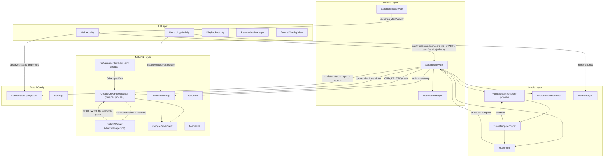
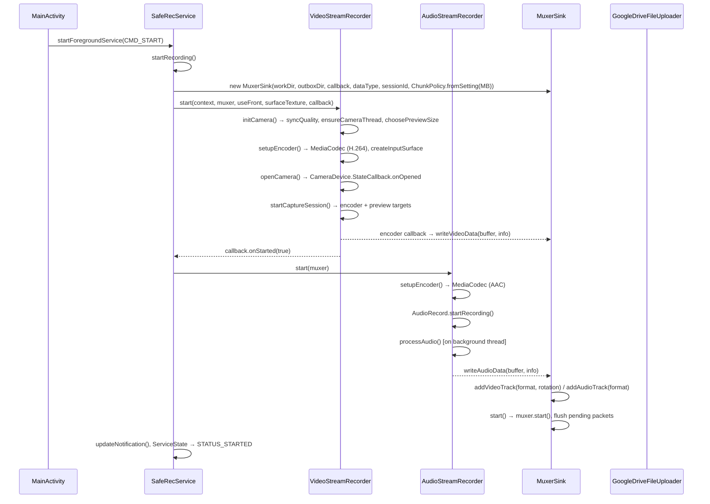
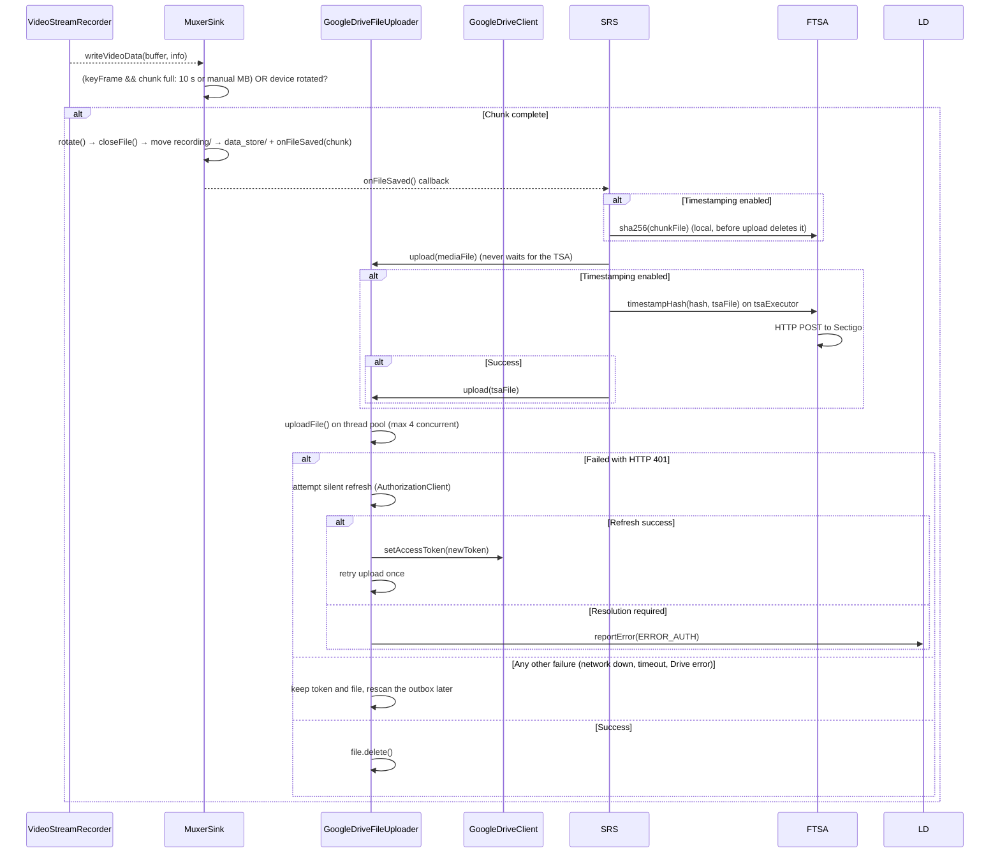
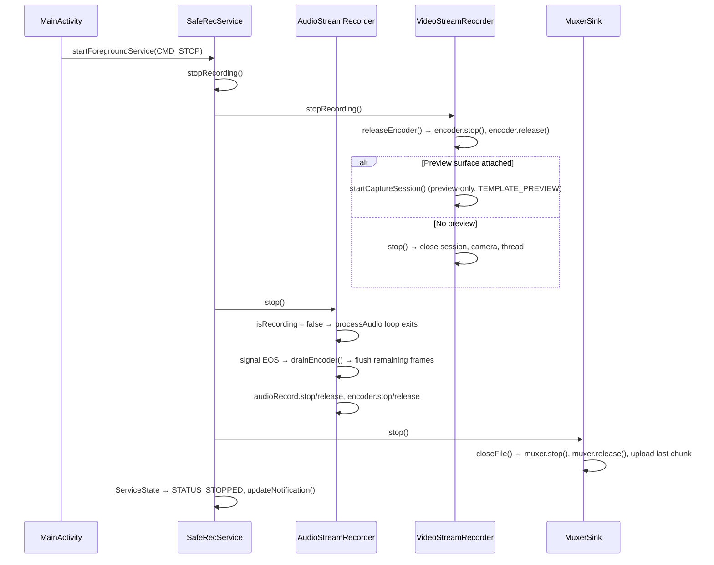

# SafeRec — Application Architecture

> **Package:** `net.ark3us.saferec`
> **Platform:** Android (Camera2 API, MediaCodec, MediaMuxer)
> **Purpose:** Background audio/video recording with chunked upload to Google Drive

---

## High-Level Architecture



---

## Reliability Rules

The app exists to save evidence when things go wrong. Keep these invariants:

1. **Record first, sync later.** Starting a recording never waits for the network, Drive or a valid token. Chunks wait on disk until an upload succeeds.
2. **Errors never stop a recording.** Upload, auth and TSA failures are reported as error events; only a total loss of camera *and* microphone ends a session.
3. **Network errors are not auth errors.** Only HTTP 401 triggers a token refresh. The background never clears the stored token: when a silent refresh needs user interaction, it reports `ERROR_AUTH` and keeps the files. Play services also ask for interaction when they cannot reach Google, and a cleared token stopped every later upload until the user reopened the app.
4. **Chunks never wait for the TSA.** Hash first, upload, then timestamp the hash.
5. **Degrade gracefully.** Camera lost → continue audio-only.
6. **The outbox holds complete chunks only.** A chunk is written in `recording/` and moved to `data_store/` when closed, so the outbox can be uploaded at any time, even mid-recording.
7. **A failed lookup is not "not found".** Drive folders are created only when Drive answered that they do not exist, and only under the uploader's lock. Treating a timeout as "not found" created duplicate `SafeRec` folders and split sessions between them.
8. **The outbox outlives the service.** Every file waiting in the outbox has a WorkManager job behind it, so a chunk recorded offline reaches Drive after a kill or a reboot without the user opening the app.

---

## Package Structure

```
net.ark3us.saferec/
├── MainActivity.java          # Main UI, preview, start/stop, settings
├── RecordingsActivity.java    # Browse/download/merge/share recordings from Drive
├── RecordingsAdapter.java     # RecyclerView adapter for recordings list
├── PlaybackActivity.java      # Video playback (streaming from Drive)
├── PermissionsManager.java    # Runtime permissions + Google Drive OAuth
│
├── data/
│   └── ServiceState.java      # Service status and one-shot errors, observed by the UI
│
├── media/
│   ├── VideoStreamRecorder.java  # Camera2 + MediaCodec video encoder (singleton)
│   ├── AudioStreamRecorder.java  # AudioRecord + MediaCodec AAC encoder
│   ├── MuxerSink.java            # MediaMuxer wrapper: chunks, one A/V clock, outbox hand-off
│   ├── ChunkPolicy.java          # When a chunk is full (10 s, or a manual size)
│   ├── VideoOrientation.java     # Orientation math (snap, hint per camera facing)
│   ├── MediaMerger.java          # Merges MP4 chunks into a single file
│   └── TimestampRenderer.java    # OpenGL ES 2.0 pipeline for burned-in timestamp overlay
│
├── misc/
│   └── Settings.java          # SharedPreferences wrapper
│
├── net/
│   ├── FileUploader.java         # Outbox queue, retry backoff, dedupe, drain (abstract: tested with a fake)
│   ├── GoogleDriveFileUploader.java  # Drive upload, folder cache, token refresh (one per process)
│   ├── OutboxWorker.java         # WorkManager job: uploads the outbox when the service is gone
│   ├── GoogleDriveClient.java    # Low-level Drive API wrapper
│   ├── DriveRecordings.java      # Recordings on Drive: list, download, share, trash
│   ├── MediaFile.java            # Chunk filename parser/generator
│   └── TsaClient.java            # RFC 3161 Time Stamping Authority client (Sectigo)
│
│
├── services/
│   ├── SafeRecService.java       # Foreground service orchestrating recording
│   ├── SafeRecTileService.java   # Quick Settings tile to start recording
│   └── NotificationHelper.java  # Notification channel + builder
│
└── ui/
    └── TutorialOverlayView.java  # First-run tutorial overlay
```

---

## Recording Lifecycle (Detail)

### 1. Start Recording



### 2. Chunking & Upload (during recording)



Failures are classified from the error itself. An extra request to check the token would run later, could find the network back, and would say nothing about the failure. A 404 (a cached Drive folder was deleted) also clears the folder cache.

Token refreshes are shared: one at a time (`refreshLock`), at most one Play services request per minute.
- A token Drive already rejected, or a missing token, goes straight to the refresh instead of sending the chunk only to get another 401.
- A token the app stored meanwhile (the user opened it) is used without asking Play services.
- Before this, each failing chunk asked on its own (8 requests in 30 s), which can get the app throttled.

### Outbox & Retry

| Directory (under `files/`) | Holds |
|-----------|-------|
| `recording/` | The chunk being written |
| `data_store/` | The outbox: complete chunks and `.tsa` replies waiting for upload |

- `MuxerSink.closeFile()` renames a finished chunk into the outbox (same filesystem, atomic) and deletes empty ones.
- `SafeRecService.onCreate()` moves orphans left in `recording/` by a crash or kill into the outbox. Such a chunk has no MP4 index and may not play, but it is kept as evidence.
- There is one `GoogleDriveFileUploader` per process (`getInstance()`), shared by the recording, `CMD_UPLOAD_PENDING` and the outbox job. The `queuedFiles` dedupe, the folder lock and the token refresh therefore cover all of them: two uploaders would each create the same Drive folders, or upload the same chunk twice.
- Each upload uses the token the app stored last, unless Drive already rejected it. The uploader lives as long as the process, across services, and the user may have reconnected Drive meanwhile.

Who retries depends on whether the service is alive:

| Service | Retries | Survives |
|---------|---------|----------|
| Alive (recording, or `dataSync` with files waiting) | `FileUploader` retry loop (`setRetryLoop(true)` in `onCreate`) plus the network callback | Nothing: it ends with the service |
| Gone (killed, `onTimeout()`, phone rebooted) | The WorkManager job `outbox` (`OutboxWorker`) | Process death and reboot |

- When an upload fails while the service lives, its file stays in the outbox, and `FileUploader` schedules one outbox rescan: 10 s, doubling up to 5 min. `onDestroy()` turns the loop off: rescans in a process without a service are not run reliably.
- A successful upload rescans the outbox immediately and resets the backoff. So does the network coming back: the default network changing, gaining a transport, or turning `VALIDATED`. A new Wi-Fi network shows up before its DNS works, so the first retry fails and the `VALIDATED` one goes through (outbox drained in 6 s instead of 23 s).
- A VPN stays the default network and stays `VALIDATED` while the phone has no network under it, so `onAvailable` never fires. Its transports do change, from `WIFI|VPN` to `VPN` and back (measured on a Galaxy S10+), and that change is the trigger.

**The outbox job** (`OutboxWorker`):
- Scheduled with `ExistingWorkPolicy.KEEP` whenever a file is queued or its upload fails (`onFilePending()`), and when the service starts with files waiting. While a job waits or runs, scheduling again does nothing, so calling it per chunk is cheap.
- It needs a network (`NetworkType.CONNECTED`) and runs 5 min after it was scheduled: while the service lives, the service does the work. A failed run comes back after 5 min, doubling up to WorkManager's 5 h cap.
- It calls `drain()`, which uploads the outbox and blocks until it is empty (success), an upload failed or the job is stopped (retry later). Uploads already running for the recording are waited for, not started twice. Chunks recorded meanwhile are uploaded in the same run: success means an empty outbox.
- Before this job, chunks left offline waited for the user to open the app again whenever the service was gone. That happened after a reboot, after the process was killed (a sticky restart only lasts until Android stops background services), or after the Android 15 `dataSync` cap.

### 3. Stop Recording



### 4. Camera Switch Mid-Recording

When the user switches front↔back during recording, [SafeRecService](app/src/main/java/net/ark3us/saferec/services/SafeRecService.java) receives a new `CMD_START`:

1. [stopRecording()](app/src/main/java/net/ark3us/saferec/MainActivity.java) — tears down audio, video, and muxer (uploads final chunk)
2. [startRecording()](app/src/main/java/net/ark3us/saferec/services/SafeRecService.java) — creates a **new session/muxer**, re-opens camera with new ID
3. This is a full restart, not a hot swap — there's a brief gap in the recording

### 5. Preview Lifecycle (Independent of Recording)

| State | Action |
|-------|--------|
| **App opens (not recording)** | [startPreview()](app/src/main/java/net/ark3us/saferec/media/VideoStreamRecorder.java) → opens camera, preview-only session (`TEMPLATE_PREVIEW`) |
| **App opens (recording in progress)** | [attachPreview()](app/src/main/java/net/ark3us/saferec/media/VideoStreamRecorder.java) → rebuilds capture session with preview + encoder |
| **App goes to background (recording)** | [detachPreview()](app/src/main/java/net/ark3us/saferec/media/VideoStreamRecorder.java) → rebuilds capture session without preview |
| **App goes to background (not recording)** | [stop()](app/src/main/java/net/ark3us/saferec/media/VideoStreamRecorder.java) | closes camera entirely |
| **Recording stops (app visible)** | [stopRecording()](app/src/main/java/net/ark3us/saferec/MainActivity.java) | releases encoder, rebuilds preview-only session |

### 6. Playback Lifecycle

- `PlaybackActivity` uses `android:configChanges` for orientation/screen changes.
- Video layout is recalculated in `onConfigurationChanged()` using cached prepared dimensions to keep aspect ratio correct after rotation.


## Key Classes

### [VideoStreamRecorder](app/src/main/java/net/ark3us/saferec/media/VideoStreamRecorder.java) — [VideoStreamRecorder.java](app/src/main/java/net/ark3us/saferec/media/VideoStreamRecorder.java)

**Singleton.** Manages Camera2 device, preview, and H.264 MediaCodec encoder.

| Field | Type | Notes |
|-------|------|-------|
| `muxer` | `volatile MuxerSink` | Set during recording, null otherwise |
| `isRecording` | `volatile boolean` | True when encoder + muxer are active |
| `encoder` | `MediaCodec` | H.264 encoder (Surface input) |
| `encoderSurface` | [Surface](app/src/main/java/net/ark3us/saferec/MainActivity.java) | Input surface from encoder |
| `cameraDevice` | `CameraDevice` | Currently open camera |
| `captureSession` | `CameraCaptureSession` | Active session |
| `previewSurface` | [Surface](app/src/main/java/net/ark3us/saferec/MainActivity.java) | From TextureView, null when no preview |
| `quality` | [Quality](app/src/main/java/net/ark3us/saferec/media/VideoStreamRecorder.java) | LOW (640×360), MEDIUM (854×480), HIGH (1280×720) |

Key methods:
- [initCamera(context, useFront)](app/src/main/java/net/ark3us/saferec/media/VideoStreamRecorder.java) — shared setup (sync quality, camera thread, preview size)
- [setupEncoder(context, cameraId)](app/src/main/java/net/ark3us/saferec/media/AudioStreamRecorder.java) — creates & starts MediaCodec with async callback
- [startCaptureSession()](app/src/main/java/net/ark3us/saferec/media/VideoStreamRecorder.java) — builds targets list (encoder + preview), sets repeating request
- `openCamera(...)` + request generation guard — ignores stale `onOpened` callbacks after stop/restart to avoid resurrecting dead sessions
- [releaseEncoder()](app/src/main/java/net/ark3us/saferec/media/VideoStreamRecorder.java) — stops & releases encoder safely
- [configureTransform(textureView)](app/src/main/java/net/ark3us/saferec/media/VideoStreamRecorder.java) — corrects preview for device rotation

**Orientation** ([VideoOrientation](app/src/main/java/net/ark3us/saferec/media/VideoOrientation.java), pure Java, unit tested):

- The device orientation comes from an `OrientationEventListener` (accelerometer). It works with the screen off (phone in a pocket) and with auto-rotate disabled, unlike the display rotation used before.
- It is snapped to 0/90/180/270 with a 15° hysteresis past the 45° boundaries, so a phone held at ~45° does not split the recording into tiny chunks.
- A phone lying flat reports nothing: the last orientation is kept. Until the first reading, the display rotation is the starting guess.
- **Hint** = `(sensor + device) % 360` for the back camera, `(sensor - device) % 360` for the front one. The front camera faces the other way. Using the back formula for both turned front videos upside down in landscape.
- On a change, the timestamp overlay turns at once. The encoder is asked for a key frame (`PARAMETER_KEY_REQUEST_SYNC_FRAME`), and `MuxerSink` starts the chunk with the new hint at that key frame. A chunk split elsewhere would start with frames that cannot be decoded.
- Verified hand-held on a Galaxy S10+ with the front camera: portrait, landscape, the other landscape and back to portrait all played upright. Every chunk started with a key frame, 23-52 ms after the turn.
- Turning from one landscape to the other passes through portrait, which leaves a short chunk (~0.5 s). A duration split just before a turn leaves one too. Both are harmless. A debounce would remove them, at the cost of recording the first part of every real turn sideways.

### [AudioStreamRecorder](app/src/main/java/net/ark3us/saferec/media/AudioStreamRecorder.java) — [AudioStreamRecorder.java](app/src/main/java/net/ark3us/saferec/media/AudioStreamRecorder.java)

Manages `AudioRecord` (mic input) and AAC MediaCodec encoder on a background thread.

- **Sample rate:** 44100 Hz, mono, PCM 16-bit
- **Bitrate:** 64 kbps AAC-LC
- **Timestamps:** `CLOCK_BOOTTIME` of the first captured frame (`AudioRecord.getTimestamp`, falling back to the read time), then the sample count: never jittery, never backwards.
- **No dropped PCM:** when the encoder has no free input buffer, the loop drains output and waits. Dropping a buffer used to shorten the audio timeline and shift all later audio against the video.
- **Stop sequence:** signals EOS to encoder, drains remaining output, then releases

Key methods:
- [processAudio()](app/src/main/java/net/ark3us/saferec/media/AudioStreamRecorder.java) — loop: read PCM → queue to encoder → [drainEncoder()](app/src/main/java/net/ark3us/saferec/media/AudioStreamRecorder.java)
- [drainEncoder(bufferInfo)](app/src/main/java/net/ark3us/saferec/media/AudioStreamRecorder.java) — pulls encoded AAC from encoder, writes to muxer

### [MuxerSink](app/src/main/java/net/ark3us/saferec/media/MuxerSink.java) — [MuxerSink.java](app/src/main/java/net/ark3us/saferec/media/MuxerSink.java)

Thread-safe (`synchronized`) wrapper around `MediaMuxer` with automatic chunking and upload.

| Concept | Implementation |
|---------|---------------|
| **Track readiness** | Waits for both audio+video tracks (or just audio if audio-only) before `muxer.start()` |
| **Pending packets** | Buffers up to 100 packets while tracks aren't ready |
| **Chunk rotation** | When the chunk is full (duration or size limit): on a video key-frame, or on any audio packet when there is no video. Also at the first key frame after the device orientation changes (one MP4 holds one orientation hint) |
| **Camera lost** | `setExpectedVideo(false)`: following chunks carry audio only (still under the `video` folder) |
| **One clock** | Video timestamps are brought to `CLOCK_BOOTTIME`, the audio clock. The camera uses `BOOTTIME` or `MONOTONIC` depending on the device, and the closer clock is picked on the first frame. |
| **PTS normalization** | One session base for both tracks (first packet written) → chunk base = first packet of the chunk minus `CHUNK_LEAD_US` (1 s) → final. The lead keeps packets of the other track captured just before the chunk's first packet, instead of dropping them. The MP4 writer moves the earliest sample to 0, and the tracks keep their real offset (edit list). |
| **File naming** | `{sessionId}_{dataType}_{timestamp}.{seq}` via [MediaFile](app/src/main/java/net/ark3us/saferec/net/MediaFile.java) |

**Chunk limit** is determined by:
1. Manual setting (`Settings.getChunkSizeMB`) if > 0: split by size, no duration limit
2. Otherwise (auto): split by duration, `ChunkPolicy.DEFAULT_DURATION_MS` = 10 s (wall clock), for both video and audio-only

Duration, not bytes, is what bounds data loss: a static or dark scene compresses well and would otherwise stretch a size-based chunk.

### [TsaClient](app/src/main/java/net/ark3us/saferec/net/TsaClient.java)

Utility to obtain cryptographically secure RFC 3161 timestamps.

- **Hash:** SHA-256
- **Provider:** `https://timestamp.sectigo.com` (Sectigo)
- **Library:** BouncyCastle (for TSQ/TSR handling)
- **Local Cache:** Saves `.tsa` files side-by-side with media chunks during background upload.
- **Off the critical path:** `sha256()` runs before the chunk upload; `timestampHash()` only needs the hash and runs later on `SafeRecService.tsaExecutor`, so a slow TSA never delays uploads. Failed timestamps are not retried.


### [TimestampRenderer](app/src/main/java/net/ark3us/saferec/media/TimestampRenderer.java) — [TimestampRenderer.java](app/src/main/java/net/ark3us/saferec/media/TimestampRenderer.java)

OpenGL ES 2.0 pipeline that composites a burned-in date/time overlay onto camera frames before they reach the encoder. Always active during video recording.

- **Pipeline:** Camera → SurfaceTexture (OES texture) → GL render (camera quad + timestamp quad) → encoder input Surface → MediaCodec
- **GL thread:** Dedicated `HandlerThread` ("TimestampGL") for all EGL/GL operations
- **Shaders:** OES external sampler for the camera pass-through, regular `sampler2D` for the text bitmap overlay
- **Text rendering:** Android `Canvas` draws the current date/time into a `Bitmap`, uploaded as a GL texture; only regenerated when the wall-clock second changes
- **Orientation:** The overlay position is defined in "display NDC" and rotated by `+recordingRotation` (CCW in GL = inverse of player's CW rotation) to map to raw-frame NDC. This single rotation matrix handles both position and text orientation for all four orientations (0°/90°/180°/270°).
- **Preview/recording parity:** Uses the same raw camera frames as the encoder (no extra sensor-rotation transform) so the recorded video orientation matches what the player expects.
- **Presentation time:** Forwards the `SurfaceTexture` timestamp to EGL via `eglPresentationTimeANDROID` for correct A/V sync
- **Preview:** The renderer only feeds the encoder. The preview Surface (TextureView) is a separate camera target, so the on-screen preview does not show the overlay.
- **Integration:** Created in `VideoStreamRecorder.setupEncoder()` for every video recording; its input surface replaces `encoderSurface` in the camera capture session targets.

### [MediaMerger](app/src/main/java/net/ark3us/saferec/media/MediaMerger.java) — [MediaMerger.java](app/src/main/java/net/ark3us/saferec/media/MediaMerger.java)

Merges multiple MP4 chunks into a single file. Used by [RecordingsActivity](app/src/main/java/net/ark3us/saferec/RecordingsActivity.java) when user taps "Merge".

- Reads video/audio formats from the first chunk
- Strips `KEY_ROTATION` from format, applies rotation via `setOrientationHint` only
- Concatenates samples with PTS offset tracking per track. Each track continues where it ended in the previous file, measured from its own first sample. Only in the first file is the gap between the tracks kept, because there it is the real offset between microphone and camera start.
- **Limitation:** Single MP4 = single rotation value. Mixed-camera sessions or merged chunks with different device rotations will have wrong orientation on some segments.

### [SafeRecService](app/src/main/java/net/ark3us/saferec/services/SafeRecService.java) — [SafeRecService.java](app/src/main/java/net/ark3us/saferec/services/SafeRecService.java)

Foreground service orchestrating the recording. Commands via `Intent` extras:

| Command | Action |
|---------|--------|
| `CMD_START` | (`startForegroundService`) If already recording: stop + restart (camera switch). Otherwise: start new recording |
| `CMD_STOP` | Stop recording, reset session |
| `CMD_UPLOAD_PENDING` | Upload the outbox now (safe while recording) |
| `CMD_DELETE` | Move Drive files (`EXTRA_FILE_IDS`) to the Drive trash, never delete them for good. Folders (`EXTRA_FOLDER_IDS`) are trashed only when they hold nothing, not even trashed files. Deleting a folder for good would also delete the trashed files in it, and keeping it lets Drive's "Restore" put files back where they were. |

State is broadcast via the [ServiceState](app/src/main/java/net/ark3us/saferec/data/ServiceState.java) singleton: `STATUS_READY` → `STATUS_STARTED` → `STATUS_STOPPED`.

Errors are a separate one-shot channel (`reportError()` / `getError()` / `clearError()`): `ERROR_AUTH` (Drive needs re-authentication), `ERROR_CAMERA` (camera lost, recording continues audio-only), `ERROR_RECORDING` (nothing can be recorded). Errors never change the recording status and never stop a recording.

Camera/encoder callbacks are posted to the main thread (`onVideoResult`) and ignored if they belong to a previous session.

**Foreground lifecycle** (`refreshForeground()`, always on the main thread, posted after each state change):

| State | Foreground | Notification |
|-------|------------|--------------|
| Recording video | `camera\|microphone` | Recording in progress |
| Recording audio only | `microphone` | Recording in progress |
| Not recording; files in the outbox, uploads, TSA or trashing running | `dataSync` | What is running, or "N files waiting to be uploaded" |
| Nothing left | leaves the foreground, `stopSelfResult(lastStartId)` | none |

- Only `CMD_START` is sent with `startForegroundService()`, and the service enters the foreground before anything else. Other commands use `startService()`: with `startForegroundService()` the service would have to enter the foreground even with nothing to do, or crash.
- Work counters (`activeTimestamping`, `activeDeletions`) go up when the work is submitted, not when its task starts. Otherwise the service could stop in between and drop the work.
- Sticky restart after the process was killed: Android forbids entering the foreground from the background, so the service never tries. It resumes the outbox as a plain background service for as long as Android lets it run. Verified on a Galaxy S10+: the waiting chunk was uploaded after the kill, with no crash.
- Android 15+ caps `dataSync` at 6 h a day: `onTimeout()` stops the service, and the outbox job takes over.

### [Settings](app/src/main/java/net/ark3us/saferec/misc/Settings.java) — [Settings.java](app/src/main/java/net/ark3us/saferec/misc/Settings.java)

SharedPreferences wrapper. Keys:

| Setting | Type | Default |
|---------|------|---------|
| `accessToken` | String | null |
| [onlyAudio](app/src/main/java/net/ark3us/saferec/misc/Settings.java) | boolean | false |
| `useFrontCamera` | boolean | false |
| `videoQuality` | String | "LOW" |
| `chunkSizeMB` | int | 0 (auto = 10 s chunks) |
| `autoStartOnLaunch` | boolean | false |
| `tutorialShown` | boolean | false |
| `shareEmail` | String | "" (last address recordings were shared with) |
| `timestampingEnabled` | boolean | false |

Security note:
- `SafeRecPrefs.xml` is excluded from Android cloud backup/device transfer/full backup rules to avoid backing up the Drive access token.


---

## Data Flow

### File Storage & Naming

```
/data/data/net.ark3us.saferec/files/
  ├── recording/                                      ← chunk being written
  └── data_store/                                     ← outbox, complete chunks only
      └── {sessionId}_{video|audio}_{timestamp}.{seq}
```

`sessionId` = `System.currentTimeMillis()` at session start.

### Google Drive Structure

```
My Drive/
  └── SafeRec/
      └── {sessionId}/
          └── {video|audio}/
              └── {timestamp}.{seq}.mp4
```

Chunks are uploaded immediately on completion and **deleted locally** on successful upload. When duplicate `SafeRec` folders exist (made by older builds), uploads go to the oldest and the recordings list reads all of them.

---

## Threading Model

| Thread | Components |
|--------|-----------|
| **Main (UI)** | MainActivity, RecordingsActivity, service commands |
| **CameraBackground** (HandlerThread) | Camera2 callbacks, MediaCodec encoder callbacks (video) |
| **Audio processing** (Thread) | `AudioStreamRecorder.processAudio()` loop |
| **Upload pool** (4 threads) | `FileUploader.uploadExecutor` |
| **Upload scan** (1 thread) | `FileUploader.scanExecutor`: outbox scans and the scheduled retry rescan |
| **WorkManager** (its own pool) | `OutboxWorker.doWork()`: blocks in `drain()` while the upload pool does the uploads |
| **Network callback** (system thread) | `SafeRecService.networkCallback`: `retryNow()` when the default network changes, gains a transport or turns `VALIDATED` |
| **Service executor** (1 thread) | `SafeRecService.executor` for pending uploads |

### Thread Safety Notes

- [MuxerSink](app/src/main/java/net/ark3us/saferec/media/MuxerSink.java): all public methods are `synchronized`
- `VideoStreamRecorder.muxer` and `.isRecording`: `volatile` for cross-thread visibility
- `VideoStreamRecorder.cameraOpenRequestCount`: `AtomicInteger` generation guard against stale async camera-open callbacks
- `AudioStreamRecorder.isRecording`: `volatile`, checked in processing loop
- `GoogleDriveFileUploader.sessionFolderIdCache`: `ConcurrentHashMap`
- `GoogleDriveFileUploader.cachedBaseFolderId`: `volatile` + double-checked locking
- `GoogleDriveFileUploader.refreshLock`: one token refresh at a time. `GoogleDriveClient.accessToken`/`driveService` are `volatile`, because a refresh replaces them while uploads run
- `FileUploader.queuedFiles`: concurrent set; a file is queued at most once, so a pending-files scan cannot upload a chunk that is already in flight (that used to create duplicates on Drive)
- `GoogleDriveFileUploader.getInstance()`: `static synchronized`, one uploader per process, so the dedupe and the folder lock above also hold between the service and the outbox job
- `FileUploader.listener` and `.retryLoop`: `volatile`, set by the service on the main thread and read by the upload threads

---

## Known Limitations

1. **Camera switch = recording gap.** Switching cameras mid-session does a full stop+restart, creating a new muxer/session segment.
2. **Mixed-rotation merge.** A single MP4 can only have one `setOrientationHint`. When chunks from different cameras (with different sensor orientations) or different device rotations are merged, some segments will display with wrong rotation.
3. **No video mirroring.** Front camera video is recorded un-mirrored (you see yourself as others see you, not as a mirror reflection). This is standard for video recording.
4. **Background Auth Failure.** If Drive rejects the access token (HTTP 401) during background upload, the app attempts a silent token refresh via Google Identity Services. If successful, the upload seamlessly resumes. If the refresh requires user interaction (e.g., token revoked or password changed), it reports `ERROR_AUTH`, prompting the user to re-authenticate, and keeps the token and the files. Later retries try the silent refresh again (at most once a minute), so uploads resume once Play services can issue a token. The recording keeps going.
5. **Slow failure behind a VPN.** With a VPN app keeping its tunnel up while the phone has no network, packets vanish and each Drive call fails only after its 20 s timeout instead of at once. Uploads that were already running when the network dropped fail when it returns, and are retried.
6. **Preview rebuild failure drops video.** `onConfigureFailed` during `attachPreview`/`detachPreview` is handled like a camera loss: the rest of the session is audio-only.
7. **A/V sync is as good as the capture timestamps.** Both tracks share `CLOCK_BOOTTIME`, but MediaMuxer does not signal the AAC encoder delay, so audio plays ~20-45 ms late. That is within lip-sync tolerance. Audio clock drift (sample rate vs system clock, typically <100 ppm) is not corrected within a session: <0.36 s per hour in the worst case.

   Measured with the `av_sync` vibration rig on a Galaxy S10+ (the rig adds its own constant, so compare values, not the absolute):
   - After a camera switch (cold camera start): +71..98 ms, versus +540..613 ms before the shared clock.
   - In a merged 50 s file: a slope of +0.9 ms/min, versus -53.5 ms/min before the fix.

   Before the shared clock, each track was normalized to its own first packet. Audio was off by the camera start delay (0.2 s with the preview open, ~1 s cold), and 1-3 audio frames were dropped at every chunk boundary, so merged files drifted further with every chunk.

8. **drive.file reaches only the app's own files.** If the `SafeRec` folder holds a file the app did not create (an older build with another OAuth client, or a file added by hand), Drive refuses any change to the folder's sharing with `appNotAuthorizedToChild`. That covers sharing it from the app and removing a public link that older builds created. Both must then be done in the Google Drive app.
9. **Sharing is per person.** The share button grants one Google account read access to the whole `SafeRec` folder, future sessions included, and Google emails that person. The app never creates "anyone with the link" access, and it cannot revoke a share: that is done in Drive.
10. **Android decides when the outbox job runs.** In Doze it waits for a maintenance window, and an app the user rarely opens gets fewer runs (App Standby buckets). After repeated failed runs it waits up to 5 h. A force stop cancels it until the next launch, and after a reboot nothing runs before the first unlock, because the outbox is in credential-encrypted storage. While the service lives, none of this applies.

---

## Testing on a Device

Unit tests (JVM, no phone, under a second): `./gradlew testDebugUnitTest`.
- `VideoOrientationTest`: quadrant snapping with hysteresis, hint for back and front cameras.
- `ChunkPolicyTest`: 10 s auto chunks whatever the size, manual size only.
- `MediaFileTest`: chunk and `.tsa` names, Drive names, foreign names rejected.
- `TsaClientTest`: SHA-256 against the FIPS test vector.
- `FileUploaderTest`: the outbox logic with a fake uploader and millisecond backoff. It covers:
  - queuing once while uploading;
  - retry from the outbox, and no retry with the loop off;
  - a success releasing waiting files at once, and `retryNow()`;
  - `drain()`: empty outbox, a failure, waiting for an upload already running, chunks recorded meanwhile, stopping.

  Breaking the dedupe, the success trigger, the loop switch or any `drain()` rule fails the matching test (checked by mutation).


`scripts/device-tests.sh` drives a connected phone (debug build, `ANDROID_SERIAL` to pick one) and checks logcat, the chunk store and chunk durations with ffprobe. Scenarios: `offline_start`, `audio_only`, `camera_stolen`, `replay`, `errors_dont_stop`, `network_drop`, `retry_after_outage`, `outbox_job`, `tsa`, `av_sync`, plus a whole-run crash check. It toggles airplane mode, records camera and mic, rewrites SafeRec settings, and restores everything on exit. It refuses to run if the outbox or `recording/` is not empty.

- `av_sync` checks sync on the content.
  - It switches camera at 3 s (a cold camera start), then vibrates the phone with 80 ms pulses at seeded irregular times. Long pulses (250 ms) failed in dim light: long exposures show motion mostly when the motor starts and stops, and the two make rival correlation peaks ~0.25 s apart. The motor is one physical event seen by both tracks: the buzz reaches the microphone and the shake moves the image.
  - `scripts/av_lag.py` cross-correlates the buzz envelope with the motion on textured pixels, per chunk.
  - It records 50 s and measures every chunk after the switch with a clear correlation peak. It passes when the median lag is within ±250 ms and at most one chunk is more than 40 ms from it. One chunk can lock onto a stray movement or noise, which once failed a run that two reruns passed. It skips when the camera used after the switch sees too dark a scene (the phone must lie so that camera sees a lit room).
  - Its own FAIL on the pre-fix build (+540..570 ms) confirmed it catches the bug.
- `outbox_job` records offline and then ends the service the way Android does. It shortens the `dataSync` time limit to 20 s (`device_config put activity_manager data_sync_fgs_timeout_duration`, removed afterwards), so `onTimeout()` stops the service. Then `am kill` removes the cached process. Back online, it waits for the job's own run (~5 min, nothing forced) and checks that the job uploaded every chunk from a new process with no service. `run-as kill` cannot do this: SELinux forbids it, and `am force-stop` would cancel the job too.
- Media scenarios also check that no frame is dropped at a chunk boundary (`Skipping … frame`), and that the first video frame is 0-1000 ms old on the shared clock (proof that both tracks use one clock).
- Checks read the host-side logcat capture (`full.log`), not the device buffer: failed uploads log long stack traces and the device buffer silently drops old lines.
- Drive scenarios (`errors_dont_stop`, `network_drop`, `retry_after_outage`, `tsa`) need a Google consent given once in the app. The OAuth client only accepts builds whose signing SHA-1 is registered in the Cloud Console, so a new dev machine's debug key must be added there first.
- Airplane mode is not an outage when a VPN app keeps its tunnel up. On Android 13+ the script also blocks SafeRec's own traffic: `cmd connectivity set-chain3-enabled` plus `set-package-networking-enabled`, restored on exit and reset at the next setup.
- The Recordings screen lists the account's real recordings. A UI test must select only the items of the session it recorded, never "select all": a test once moved the owner's own recordings to the trash (restored, thanks to the trash).
- `run-as` processes have no network permission, so `run-as … nc` or `curl` says nothing about the app's connectivity. Compare `/proc/net/dev` counters instead.

Lesson learned: video encoders emit SPS/PPS as a `BUFFER_FLAG_CODEC_CONFIG` buffer with PTS 0. Writing it as a sample made 0 the video time base and silently dropped all audio after the first chunk. Codec config buffers must never reach `MuxerSink`.

Lesson learned: `findFolderId` used to return null both for "no such folder" and for a timeout, so a lookup during an outage created a second `SafeRec` folder. A token-refresh retry also resolved folders outside the uploader's lock, so two threads built the same session folders in parallel. Lookups now throw on errors, and only `getOrCacheSessionFolderId` creates folders.
