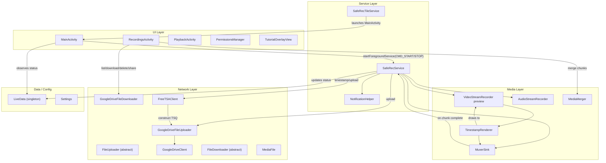
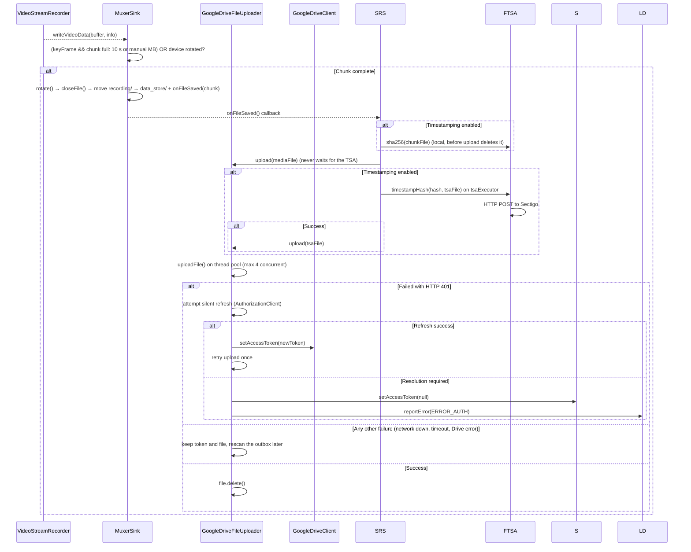
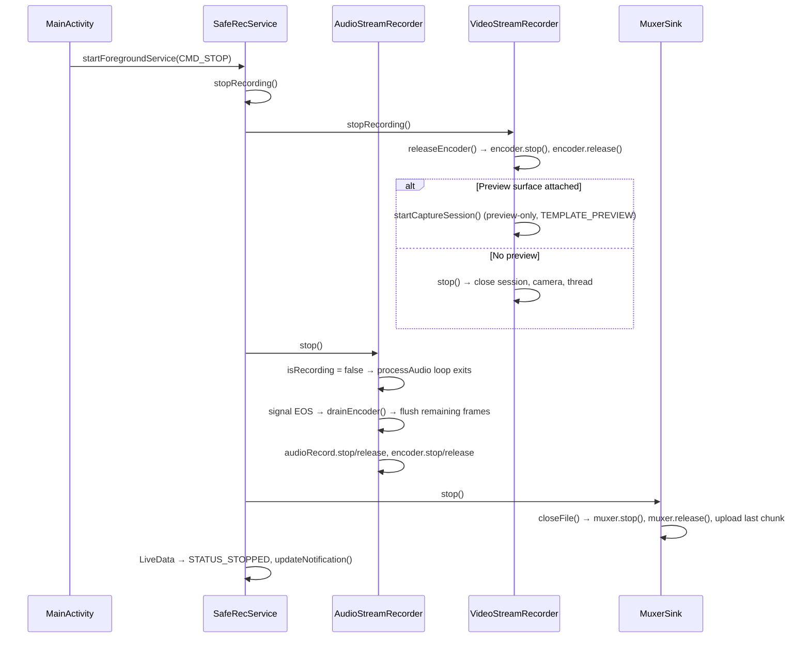

# SafeRec — Application Architecture

> **Package:** `net.ark3us.saferec`
> **Platform:** Android (Camera2 API, MediaCodec, MediaMuxer)
> **Purpose:** Background audio/video recording with chunked upload to Google Drive

---

## High-Level Architecture



---

## Reliability Rules

The app exists to save evidence when things go wrong. Keep these invariants:

1. **Record first, sync later.** Starting a recording never waits for the network, Drive or a valid token. Chunks wait on disk until an upload succeeds.
2. **Errors never stop a recording.** Upload, auth and TSA failures are reported as error events; only a total loss of camera *and* microphone ends a session.
3. **Network errors are not auth errors.** The access token is cleared only when Drive answers HTTP 401 and a silent refresh needs user interaction.
4. **Chunks never wait for the TSA.** Hash first, upload, then timestamp the hash.
5. **Degrade gracefully.** Camera lost → continue audio-only.
6. **The outbox holds complete chunks only.** A chunk is written in `recording/` and moved to `data_store/` when closed, so the outbox can be uploaded at any time, even mid-recording.
7. **A failed lookup is not "not found".** Drive folders are created only when Drive answered that they do not exist, and only under the uploader's lock. Treating a timeout as "not found" created duplicate `SafeRec` folders and split sessions between them.

---

## Package Structure

```
net.ark3us.saferec/
├── MainActivity.java          # Main UI, preview, start/stop, settings
├── RecordingsActivity.java    # Browse/download/merge/share recordings from Drive
├── RecordingsAdapter.java     # RecyclerView adapter for recordings list
├── PlaybackActivity.java      # Video playback (streaming from Drive)
├── PermissionsManager.java    # Runtime permissions + Google Drive OAuth
│
├── data/
│   └── LiveData.java          # Singleton observable for service status
│
├── media/
│   ├── VideoStreamRecorder.java  # Camera2 + MediaCodec video encoder (singleton)
│   ├── AudioStreamRecorder.java  # AudioRecord + MediaCodec AAC encoder
│   ├── MuxerSink.java            # MediaMuxer wrapper with chunking + upload
│   ├── MediaMerger.java          # Merges MP4 chunks into a single file
│   └── TimestampRenderer.java    # OpenGL ES 2.0 pipeline for burned-in timestamp overlay
│
├── misc/
│   └── Settings.java          # SharedPreferences wrapper
│
├── net/
│   ├── FileUploader.java         # Abstract uploader with thread pool
│   ├── GoogleDriveFileUploader.java  # Drive upload implementation
│   ├── GoogleDriveClient.java    # Low-level Drive API wrapper
│   ├── FileDownloader.java       # Abstract downloader
│   ├── GoogleDriveFileDownloader.java  # Drive download implementation
│   ├── MediaFile.java           # Chunk filename parser/generator
│   └── FreeTSAClient.java       # Timestamp Authority (TSA) client (Sectigo)
│
│
├── services/
│   ├── SafeRecService.java       # Foreground service orchestrating recording
│   ├── SafeRecTileService.java   # Quick Settings tile to start recording
│   └── NotificationHelper.java  # Notification channel + builder
│
└── ui/
    └── TutorialOverlayView.java  # First-run tutorial overlay
```

---

## Recording Lifecycle (Detail)

### 1. Start Recording


### 2. Chunking & Upload (during recording)



Failures are classified from the error itself. An extra request to check the token would run later, could find the network back, and would say nothing about the failure. A 404 (a cached Drive folder was deleted) also clears the folder cache.

### Outbox & Retry

| Directory (under `files/`) | Holds |
|-----------|-------|
| `recording/` | The chunk being written |
| `data_store/` | The outbox: complete chunks and `.tsa` replies waiting for upload |

- `MuxerSink.closeFile()` renames a finished chunk into the outbox (same filesystem, atomic) and deletes empty ones.
- `SafeRecService.onCreate()` moves orphans left in `recording/` by a crash or kill into the outbox. Such a chunk has no MP4 index and may not play, but it is kept as evidence.
- The service owns one `GoogleDriveFileUploader` (`ensureUploader()`), shared by the recording and `CMD_UPLOAD_PENDING`, so the `queuedFiles` dedupe covers both.
- When an upload fails, its file stays in the outbox, and `FileUploader` schedules one outbox rescan: 10 s, doubling up to 5 min.
- A successful upload, or a new default network (`onAvailable`), rescans the outbox immediately and resets the backoff.

### 3. Stop Recording



### 4. Camera Switch Mid-Recording

When the user switches front↔back during recording, [SafeRecService](file:///home/ark3us/Filen/Dev/SafeRec/app/src/main/java/net/ark3us/saferec/services/SafeRecService.java#21-227) receives a new `CMD_START`:

1. [stopRecording()](file:///home/ark3us/Filen/Dev/SafeRec/app/src/main/java/net/ark3us/saferec/MainActivity.java#523-530) — tears down audio, video, and muxer (uploads final chunk)
2. [startRecording()](file:///home/ark3us/Filen/Dev/SafeRec/app/src/main/java/net/ark3us/saferec/services/SafeRecService.java#112-181) — creates a **new session/muxer**, re-opens camera with new ID
3. This is a full restart, not a hot swap — there's a brief gap in the recording

### 5. Preview Lifecycle (Independent of Recording)

| State | Action |
|-------|--------|
| **App opens (not recording)** | [startPreview()](file:///home/ark3us/Filen/Dev/SafeRec/app/src/main/java/net/ark3us/saferec/media/VideoStreamRecorder.java#121-140) → opens camera, preview-only session (`TEMPLATE_PREVIEW`) |
| **App opens (recording in progress)** | [attachPreview()](file:///home/ark3us/Filen/Dev/SafeRec/app/src/main/java/net/ark3us/saferec/media/VideoStreamRecorder.java#271-287) → rebuilds capture session with preview + encoder |
| **App goes to background (recording)** | [detachPreview()](file:///home/ark3us/Filen/Dev/SafeRec/app/src/main/java/net/ark3us/saferec/media/VideoStreamRecorder.java#256-270) → rebuilds capture session without preview |
| **App goes to background (not recording)** | [stop()](file:///home/ark3us/Filen/Dev/SafeRec/app/src/main/java/net/ark3us/saferec/media/VideoStreamRecorder.java#240-255) | closes camera entirely |
| **Recording stops (app visible)** | [stopRecording()](file:///home/ark3us/Filen/Dev/SafeRec/app/src/main/java/net/ark3us/saferec/MainActivity.java#523-530) | releases encoder, rebuilds preview-only session |

### 6. Playback Lifecycle

- `PlaybackActivity` uses `android:configChanges` for orientation/screen changes.
- Video layout is recalculated in `onConfigurationChanged()` using cached prepared dimensions to keep aspect ratio correct after rotation.


## Key Classes

### [VideoStreamRecorder](file:///home/ark3us/Filen/Dev/SafeRec/app/src/main/java/net/ark3us/saferec/media/VideoStreamRecorder.java#32-584) — [VideoStreamRecorder.java](file:///home/ark3us/Filen/Dev/SafeRec/app/src/main/java/net/ark3us/saferec/media/VideoStreamRecorder.java)

**Singleton.** Manages Camera2 device, preview, and H.264 MediaCodec encoder.

| Field | Type | Notes |
|-------|------|-------|
| `muxer` | `volatile MuxerSink` | Set during recording, null otherwise |
| `isRecording` | `volatile boolean` | True when encoder + muxer are active |
| `encoder` | `MediaCodec` | H.264 encoder (Surface input) |
| `encoderSurface` | [Surface](file:///home/ark3us/Filen/Dev/SafeRec/app/src/main/java/net/ark3us/saferec/MainActivity.java#165-168) | Input surface from encoder |
| `cameraDevice` | `CameraDevice` | Currently open camera |
| `captureSession` | `CameraCaptureSession` | Active session |
| `previewSurface` | [Surface](file:///home/ark3us/Filen/Dev/SafeRec/app/src/main/java/net/ark3us/saferec/MainActivity.java#165-168) | From TextureView, null when no preview |
| `quality` | [Quality](file:///home/ark3us/Filen/Dev/SafeRec/app/src/main/java/net/ark3us/saferec/media/VideoStreamRecorder.java#37-71) | LOW (640×360), MEDIUM (854×480), HIGH (1280×720) |

Key methods:
- [initCamera(context, useFront)](file:///home/ark3us/Filen/Dev/SafeRec/app/src/main/java/net/ark3us/saferec/media/VideoStreamRecorder.java#290-304) — shared setup (sync quality, camera thread, preview size)
- [setupEncoder(context, cameraId)](file:///home/ark3us/Filen/Dev/SafeRec/app/src/main/java/net/ark3us/saferec/media/AudioStreamRecorder.java#105-120) — creates & starts MediaCodec with async callback
- [startCaptureSession()](file:///home/ark3us/Filen/Dev/SafeRec/app/src/main/java/net/ark3us/saferec/media/VideoStreamRecorder.java#504-554) — builds targets list (encoder + preview), sets repeating request
- `openCamera(...)` + request generation guard — ignores stale `onOpened` callbacks after stop/restart to avoid resurrecting dead sessions
- [releaseEncoder()](file:///home/ark3us/Filen/Dev/SafeRec/app/src/main/java/net/ark3us/saferec/media/VideoStreamRecorder.java#305-321) — stops & releases encoder safely
- [configureTransform(textureView)](file:///home/ark3us/Filen/Dev/SafeRec/app/src/main/java/net/ark3us/saferec/media/VideoStreamRecorder.java#141-197) — corrects preview for device rotation

**Rotation formula:** [(sensorOrientation - deviceRotation + 360) % 360](file:///home/ark3us/Filen/Dev/SafeRec/app/src/main/java/net/ark3us/saferec/media/VideoStreamRecorder.java#240-255) — same for front and back cameras.

### [AudioStreamRecorder](file:///home/ark3us/Filen/Dev/SafeRec/app/src/main/java/net/ark3us/saferec/media/AudioStreamRecorder.java#18-179) — [AudioStreamRecorder.java](file:///home/ark3us/Filen/Dev/SafeRec/app/src/main/java/net/ark3us/saferec/media/AudioStreamRecorder.java)

Manages `AudioRecord` (mic input) and AAC MediaCodec encoder on a background thread.

- **Sample rate:** 44100 Hz, mono, PCM 16-bit
- **Bitrate:** 64 kbps AAC-LC
- **Stop sequence:** signals EOS to encoder, drains remaining output, then releases

Key methods:
- [processAudio()](file:///home/ark3us/Filen/Dev/SafeRec/app/src/main/java/net/ark3us/saferec/media/AudioStreamRecorder.java#121-158) — loop: read PCM → queue to encoder → [drainEncoder()](file:///home/ark3us/Filen/Dev/SafeRec/app/src/main/java/net/ark3us/saferec/media/AudioStreamRecorder.java#159-178)
- [drainEncoder(bufferInfo)](file:///home/ark3us/Filen/Dev/SafeRec/app/src/main/java/net/ark3us/saferec/media/AudioStreamRecorder.java#159-178) — pulls encoded AAC from encoder, writes to muxer

### [MuxerSink](file:///home/ark3us/Filen/Dev/SafeRec/app/src/main/java/net/ark3us/saferec/media/MuxerSink.java#17-263) — [MuxerSink.java](file:///home/ark3us/Filen/Dev/SafeRec/app/src/main/java/net/ark3us/saferec/media/MuxerSink.java)

Thread-safe (`synchronized`) wrapper around `MediaMuxer` with automatic chunking and upload.

| Concept | Implementation |
|---------|---------------|
| **Track readiness** | Waits for both audio+video tracks (or just audio if audio-only) before `muxer.start()` |
| **Pending packets** | Buffers up to 100 packets while tracks aren't ready |
| **Chunk rotation** | When the chunk is full (duration or size limit): on a video key-frame, or on any audio packet when there is no video. Also when device rotation changes |
| **Camera lost** | `setExpectedVideo(false)`: following chunks carry audio only (still under the `video` folder) |
| **PTS normalization** | 3-layer: session base → chunk base → final (always ≥ 0) |
| **File naming** | `{sessionId}_{dataType}_{timestamp}.{seq}` via [MediaFile](file:///home/ark3us/Filen/Dev/SafeRec/app/src/main/java/net/ark3us/saferec/net/MediaFile.java#7-71) |

**Chunk limit** is determined by:
1. Manual setting (`Settings.getChunkSizeMB`) if > 0: split by size, no duration limit
2. Otherwise (auto): split by duration, `DEFAULT_CHUNK_DURATION_MS` = 10 s (wall clock), for both video and audio-only

Duration, not bytes, is what bounds data loss: a static or dark scene compresses well and would otherwise stretch a size-based chunk.

### [FreeTSAClient](file:///home/ark3us/Filen/Dev/SafeRec/app/src/main/java/net/ark3us/saferec/net/FreeTSAClient.java) — [FreeTSAClient.java](file:///home/ark3us/Filen/Dev/SafeRec/app/src/main/java/net/ark3us/saferec/net/FreeTSAClient.java)

Utility to obtain cryptographically secure RFC 3161 timestamps.

- **Hash:** SHA-256
- **Provider:** `https://timestamp.sectigo.com` (Sectigo)
- **Library:** BouncyCastle (for TSQ/TSR handling)
- **Local Cache:** Saves `.tsa` files side-by-side with media chunks during background upload.
- **Off the critical path:** `sha256()` runs before the chunk upload; `timestampHash()` only needs the hash and runs later on `SafeRecService.tsaExecutor`, so a slow TSA never delays uploads. Failed timestamps are not retried.


### [TimestampRenderer](file:///home/ark3us/Filen/Dev/SafeRec/app/src/main/java/net/ark3us/saferec/media/TimestampRenderer.java) — [TimestampRenderer.java](file:///home/ark3us/Filen/Dev/SafeRec/app/src/main/java/net/ark3us/saferec/media/TimestampRenderer.java)

OpenGL ES 2.0 pipeline that composites a burned-in date/time overlay onto camera frames before they reach the encoder. Always active during video recording.

- **Pipeline:** Camera → SurfaceTexture (OES texture) → GL render (camera quad + timestamp quad) → encoder input Surface → MediaCodec
- **GL thread:** Dedicated `HandlerThread` ("TimestampGL") for all EGL/GL operations
- **Shaders:** OES external sampler for the camera pass-through, regular `sampler2D` for the text bitmap overlay
- **Text rendering:** Android `Canvas` draws the current date/time into a `Bitmap`, uploaded as a GL texture; only regenerated when the wall-clock second changes
- **Orientation:** The overlay position is defined in "display NDC" and rotated by `+recordingRotation` (CCW in GL = inverse of player's CW rotation) to map to raw-frame NDC. This single rotation matrix handles both position and text orientation for all four orientations (0°/90°/180°/270°).
- **Preview/recording parity:** Uses the same raw camera frames as the encoder (no extra sensor-rotation transform) so the recorded video orientation matches what the player expects.
- **Presentation time:** Forwards the `SurfaceTexture` timestamp to EGL via `eglPresentationTimeANDROID` for correct A/V sync
- **Preview:** The renderer only feeds the encoder. The preview Surface (TextureView) is a separate camera target, so the on-screen preview does not show the overlay.
- **Integration:** Created in `VideoStreamRecorder.setupEncoder()` for every video recording; its input surface replaces `encoderSurface` in the camera capture session targets.

### [MediaMerger](file:///home/ark3us/Filen/Dev/SafeRec/app/src/main/java/net/ark3us/saferec/media/MediaMerger.java#14-169) — [MediaMerger.java](file:///home/ark3us/Filen/Dev/SafeRec/app/src/main/java/net/ark3us/saferec/media/MediaMerger.java)

Merges multiple MP4 chunks into a single file. Used by [RecordingsActivity](file:///home/ark3us/Filen/Dev/SafeRec/app/src/main/java/net/ark3us/saferec/RecordingsActivity.java#40-332) when user taps "Merge".

- Reads video/audio formats from the first chunk
- Strips `KEY_ROTATION` from format, applies rotation via `setOrientationHint` only
- Concatenates samples with PTS offset tracking per track
- **Limitation:** Single MP4 = single rotation value. Mixed-camera sessions or merged chunks with different device rotations will have wrong orientation on some segments.

### [SafeRecService](file:///home/ark3us/Filen/Dev/SafeRec/app/src/main/java/net/ark3us/saferec/services/SafeRecService.java#21-227) — [SafeRecService.java](file:///home/ark3us/Filen/Dev/SafeRec/app/src/main/java/net/ark3us/saferec/services/SafeRecService.java)

Foreground service orchestrating the recording. Commands via `Intent` extras:

| Command | Action |
|---------|--------|
| `CMD_START` | If already recording: stop + restart (camera switch). Otherwise: start new recording |
| `CMD_STOP` | Stop recording, reset session |
| `CMD_UPLOAD_PENDING` | Upload the outbox now (safe while recording) |
| `CMD_DELETE` | Delete Drive files (`EXTRA_FILE_IDS`) and clean up empty folders (`EXTRA_FOLDER_IDS`) |

State is broadcast via [LiveData](file:///home/ark3us/Filen/Dev/SafeRec/app/src/main/java/net/ark3us/saferec/data/LiveData.java) singleton: `STATUS_READY` → `STATUS_STARTED` → `STATUS_STOPPED`.

Errors are a separate one-shot channel (`reportError()` / `getError()` / `clearError()`): `ERROR_AUTH` (Drive needs re-authentication), `ERROR_CAMERA` (camera lost, recording continues audio-only), `ERROR_RECORDING` (nothing can be recorded). Errors never change the recording status and never stop a recording.

Camera/encoder callbacks are posted to the main thread (`onVideoResult`) and ignored if they belong to a previous session.

### [Settings](file:///home/ark3us/Filen/Dev/SafeRec/app/src/main/java/net/ark3us/saferec/misc/Settings.java#7-78) — [Settings.java](file:///home/ark3us/Filen/Dev/SafeRec/app/src/main/java/net/ark3us/saferec/misc/Settings.java)

SharedPreferences wrapper. Keys:

| Setting | Type | Default |
|---------|------|---------|
| `accessToken` | String | null |
| [onlyAudio](file:///home/ark3us/Filen/Dev/SafeRec/app/src/main/java/net/ark3us/saferec/misc/Settings.java#25-28) | boolean | false |
| `useFrontCamera` | boolean | false |
| `videoQuality` | String | "LOW" |
| `chunkSizeMB` | int | 0 (auto = 10 s chunks) |
| `autoStartOnLaunch` | boolean | false |
| `tutorialShown` | boolean | false |
| `timestampingEnabled` | boolean | false |

Security note:
- `SafeRecPrefs.xml` is excluded from Android cloud backup/device transfer/full backup rules to avoid backing up the Drive access token.


---

## Data Flow

### File Storage & Naming

```
/data/data/net.ark3us.saferec/files/
  ├── recording/                                      ← chunk being written
  └── data_store/                                     ← outbox, complete chunks only
      └── {sessionId}_{video|audio}_{timestamp}.{seq}
```

`sessionId` = `System.currentTimeMillis()` at session start.

### Google Drive Structure

```
My Drive/
  └── SafeRec/
      └── {sessionId}/
          └── {video|audio}/
              └── {timestamp}.{seq}.mp4
```

Chunks are uploaded immediately on completion and **deleted locally** on successful upload. When duplicate `SafeRec` folders exist (made by older builds), uploads go to the oldest and the recordings list reads all of them.

---

## Threading Model

| Thread | Components |
|--------|-----------|
| **Main (UI)** | MainActivity, RecordingsActivity, service commands |
| **CameraBackground** (HandlerThread) | Camera2 callbacks, MediaCodec encoder callbacks (video) |
| **Audio processing** (Thread) | `AudioStreamRecorder.processAudio()` loop |
| **Upload pool** (4 threads) | `FileUploader.uploadExecutor` |
| **Upload scan** (1 thread) | `FileUploader.scanExecutor`: outbox scans and the scheduled retry rescan |
| **Network callback** (system thread) | `SafeRecService.networkCallback` → `retryNow()` |
| **Service executor** (1 thread) | `SafeRecService.executor` for pending uploads |

### Thread Safety Notes

- [MuxerSink](file:///home/ark3us/Filen/Dev/SafeRec/app/src/main/java/net/ark3us/saferec/media/MuxerSink.java#17-263): all public methods are `synchronized`
- `VideoStreamRecorder.muxer` and `.isRecording`: `volatile` for cross-thread visibility
- `VideoStreamRecorder.cameraOpenRequestCount`: `AtomicInteger` generation guard against stale async camera-open callbacks
- `AudioStreamRecorder.isRecording`: `volatile`, checked in processing loop
- `GoogleDriveFileUploader.sessionFolderIdCache`: `ConcurrentHashMap`
- `GoogleDriveFileUploader.cachedBaseFolderId`: `volatile` + double-checked locking
- `FileUploader.queuedFiles`: concurrent set; a file is queued at most once, so a pending-files scan cannot upload a chunk that is already in flight (that used to create duplicates on Drive)

---

## Known Limitations

1. **Camera switch = recording gap.** Switching cameras mid-session does a full stop+restart, creating a new muxer/session segment.
2. **Mixed-rotation merge.** A single MP4 can only have one `setOrientationHint`. When chunks from different cameras (with different sensor orientations) or different device rotations are merged, some segments will display with wrong rotation.
3. **No video mirroring.** Front camera video is recorded un-mirrored (you see yourself as others see you, not as a mirror reflection). This is standard for video recording.
4. **Background Auth Failure.** If Drive rejects the access token (HTTP 401) during background upload, the app attempts a silent token refresh via Google Identity Services. If successful, the upload seamlessly resumes. If the refresh requires user interaction (e.g., token revoked or password changed), it clears the token and reports `ERROR_AUTH`, prompting the user to re-authenticate. The recording keeps going. Network errors never clear the token.
5. **Slow failure behind a VPN.** With a VPN app keeping its tunnel up while the phone has no network, packets vanish and each Drive call fails only after its 20 s timeout. `onAvailable` may never fire, because the VPN stays the default network. Recovery then relies on the backoff and on the next successful upload.
6. **Preview rebuild failure drops video.** `onConfigureFailed` during `attachPreview`/`detachPreview` is handled like a camera loss: the rest of the session is audio-only.
7. **Audio ~1 s behind video.** Audio and video are normalized to their own first packet, but audio starts before the camera delivers its first frame. Measured on a Galaxy S10+: chunk #0 holds ~10.1 s of audio vs ~9.0 s of video, and the offset persists for the session. A few audio frames (~70 ms) are also dropped at each chunk boundary. Fix needs one shared clock for both tracks.

---

## Testing on a Device

`scripts/device-tests.sh` drives a connected phone (debug build, `ANDROID_SERIAL` to pick one) and checks logcat, the chunk store and chunk durations with ffprobe. Scenarios: `offline_start`, `audio_only`, `camera_stolen`, `replay`, `errors_dont_stop`, `network_drop`, `retry_after_outage`, `tsa`, plus a whole-run crash check. It toggles airplane mode, records camera and mic, rewrites SafeRec settings, and restores everything on exit. It refuses to run if the outbox or `recording/` is not empty.

- Checks read the host-side logcat capture (`full.log`), not the device buffer: failed uploads log long stack traces and the device buffer silently drops old lines.
- Drive scenarios (`errors_dont_stop`, `network_drop`, `retry_after_outage`, `tsa`) need a Google consent given once in the app. The OAuth client only accepts builds whose signing SHA-1 is registered in the Cloud Console, so a new dev machine's debug key must be added there first.
- Airplane mode is not an outage when a VPN app keeps its tunnel up. On Android 13+ the script also blocks SafeRec's own traffic: `cmd connectivity set-chain3-enabled` plus `set-package-networking-enabled`, restored on exit and reset at the next setup.
- `run-as` processes have no network permission, so `run-as … nc` or `curl` says nothing about the app's connectivity. Compare `/proc/net/dev` counters instead.

Lesson learned: video encoders emit SPS/PPS as a `BUFFER_FLAG_CODEC_CONFIG` buffer with PTS 0. Writing it as a sample made 0 the video time base and silently dropped all audio after the first chunk. Codec config buffers must never reach `MuxerSink`.

Lesson learned: `findFolderId` used to return null both for "no such folder" and for a timeout, so a lookup during an outage created a second `SafeRec` folder. A token-refresh retry also resolved folders outside the uploader's lock, so two threads built the same session folders in parallel. Lookups now throw on errors, and only `getOrCacheSessionFolderId` creates folders.
