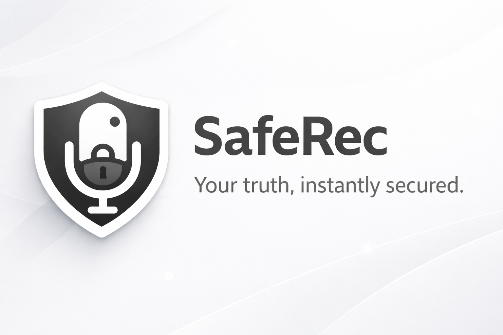

# SafeRec

**[Download the latest version](https://github.com/ark3us/saferec/releases/latest)** (APK, see [Install](#install))

Record video or audio in an emergency. Every 10 seconds the recording is saved to your Google Drive, while you record. If the phone is taken or broken, what was recorded is already safe.

Open source, Android 8.0+, English and Italian.

## Why

A normal camera app saves the video when you stop. Lose the phone before that and you lose everything. SafeRec uploads as it goes.

## Features

**Start fast, even locked**
- Press the power key 4 times (3 to 5, your choice), with the phone locked and the screen off (optional). Turn off "Lift to check phone": a screen lit by lifting counts as a press.
- Quick settings tile, also on the lock screen.
- "Record now" shortcut on the app icon.
- Double press of the power key, if your phone lets another app take it (optional).
- Two short vibrations confirm the recording. Three short ones mean nothing is recording.

**Stop on purpose**
- Hold the record button for half a second. A tap does not stop.
- Stopping from the notification needs the unlocked phone.
- Or press the power key 4 times again, if you use the presses: one long vibration.

**Safe on Drive**
- Pieces of 10 seconds, uploaded while recording.
- No network? Pieces wait on the phone and upload by themselves later, even after a reboot.
- A piece cut by a crash or a power cut is repaired. The original is kept too.
- SafeRec can only see the files it created on your Drive.

**Discreet**
- No sound. The notification is hidden on the lock screen.
- Audio-only mode.
- Android still shows its camera and microphone indicator: no app can hide it.

**Your recordings**
- One card per recording, with its status: Complete, Uploading, Incomplete or Not checked.
- Plays the whole recording as one video, straight from Drive.
- Share the video, or move it to the Drive trash (kept 30 days).
- Share all your recordings with a trusted person (read only, from Settings).

**Evidence**
- Date and time burned into every video frame.
- Each recording keeps a list of its pieces with their SHA-256 fingerprints, so a missing or changed piece shows.
- Optional certified time: Sectigo, an independent authority, timestamps each piece. Only the fingerprint is sent.
- "Export evidence package": one zip with the video, every original file, a report and a verifier. The phone checks it before sharing.

**Settings**
- Video quality: 360p, 480p or 720p.
- Front or back camera, for the app and for quick starts.

## Install

SafeRec is distributed here on GitHub, not on the Play Store.

1. On the phone, open the [latest release](https://github.com/ark3us/saferec/releases/latest) and download `SafeRec-<version>.apk`.
2. Open it. The first time, Android asks to allow installs from your browser: allow it, go back, install.
3. To update, download the new APK the same way: it installs over the old one and keeps your settings. An app such as [Obtainium](https://github.com/ImranR98/Obtainium) can watch the releases for you.

Check the download (optional, on a computer):
- `sha256sum -c SHA256SUMS`, with the `SHA256SUMS` file of the same release next to the APK.
- `apksigner verify --print-certs SafeRec-<version>.apk` must print `certificate SHA-256 digest: 0a541d9a8dfc3c06ee9ec231bdd3de307ad9328cfa82aa0ba53ad6b247ec52bc` (`0A:54:1D:9A:8D:FC:3C:06:EE:9E:C2:31:BD:D3:DE:30:7A:D9:32:8C:FA:82:AA:0B:A5:3A:D6:B2:47:EC:52:BC` in `keytool`'s form). It is the key registered for `net.ark3us.saferec.app` with Android: every update carries the same one.

## Verify a recording

Anyone (a lawyer, an expert, a court) can check a recording without trusting the app or Google.

The easy way: open the recording, tap **Export evidence package**, share the zip. Inside, run:

```
uv run verify_session.py evidence
```

Or from Drive:
1. Download the recording's folder (named after its start time, e.g. `1792429746374`) and unzip it.
2. Install [uv](https://docs.astral.sh/uv/) and make sure `openssl` is available.
3. From this repository: `uv run scripts/verify_session.py <folder>`

It checks every piece against the list, and the timestamps up to a trusted root. It ends with **COMPLETE** or **NOT VERIFIED** and the reason.

## Privacy

No servers of ours. Recordings go from your phone to your Google Drive. With certified time on, Sectigo gets only each piece's fingerprint. Details: [privacy policy](privacy_policy.html).

## Build it yourself

You need Android Studio, JDK 17 or newer and a Google Cloud project with the Drive API.

1. Clone: `git clone https://github.com/ark3us/saferec.git`
2. In the [Google Cloud Console](https://console.cloud.google.com/):
   - enable the **Google Drive API**;
   - set up the OAuth consent screen (External) with the scope `.../auth/drive.file`;
   - create an **Android** OAuth client: your own application id (below), your SHA-1.
3. Your debug SHA-1:
   ```
   keytool -list -v -keystore ~/.android/debug.keystore -alias androiddebugkey -storepass android -keypass android
   ```
4. Use your own application id. `net.ark3us.saferec.app` is registered with Android to SafeRec's signing key: from 2027, an APK with that id signed with another key does not install on certified phones. Change it in three places together:
   - `applicationId` in `app/build.gradle.kts`;
   - `android:targetPackage` in `app/src/main/res/xml/shortcuts.xml`, or the "Record now" shortcut breaks;
   - `ApplicationIdTest`, which checks the other two.
5. Build: `./gradlew assembleDebug`

Without the power key presses (no special foreground service): add `-Psaferec.powerGesture=false`.

How it works inside: [AGENTS.md](AGENTS.md).

## Credits

Developed with the assistance of **Antigravity**.

Video playback: [Media3](https://developer.android.com/media/media3) (ExoPlayer) by Google, Apache License 2.0.

Icons: [Material Symbols](https://fonts.google.com/icons) by Google, Apache License 2.0.

## License

GNU General Public License v3.0, see [LICENSE](LICENSE).
